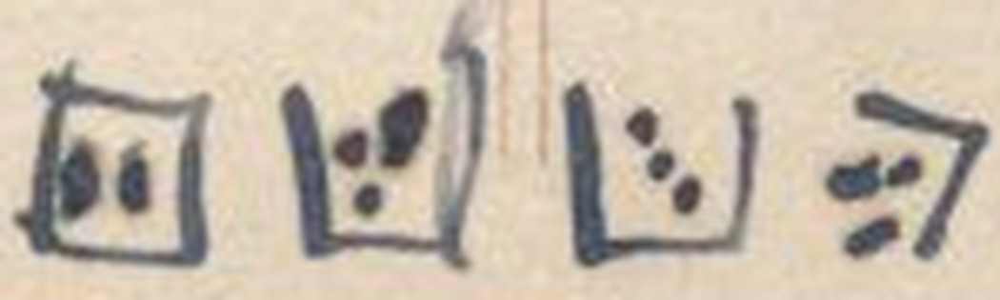

# HCP 1131 (cpc_-04-19_USA_Hoxie, Kansas_USA_Selden, Kansas_): a dotted Pigpen postcard to Olive Ritter

Human solver: Tomáš Pavuk

**Status: deciphered in full (74 of 74 cipher glyphs, 25 English words); independent review 1 verdict ACCEPT, no change to the decoded letters.** Report dated 2026-10-29.

## Origin and context

The cryptogram is record 1131 of the HC Portal (https://crypto.hcportal.eu/dashboard/cryptograms/1131), portal name cpc_-04-19_USA_Hoxie, Kansas_USA_Selden, Kansas_, part of Tobias Schrödel's collection of cryptographic postcards (private collection; collection reference https://ecp.ep.liu.se/index.php/histocrypt/article/view/166). When it was captured on 2026-10-25 the portal listed it as **Not solved**, tagged Postcard, T. Schrödel Collection and Pigpen, category Substitution / Monoalphabetic, date and language Unknown, sender Unknown, recipient Olive Ritter, with no transcription or solution attached.

The picture side shows printed lilies and carries no cipher. The address side is addressed in plain writing to **Miss Olive Ritter, Selden, Kans.** and is postmarked **HOXIE / KANS., APR 19, 1 PM**, with a year that reads "190?" (the last digit is illegible). Hoxie and Selden are both small towns in Sheridan County, north-west Kansas, so the card travelled only a short distance. The green one-cent Franklin stamp is of the Washington–Franklin design introduced in 1908, so a date of about 1908–1909 is likely but not certain. The card is unsigned.

The cipher occupies the left half of the address side: eight uneven rows of square Pigpen-type signs, each with one to three dots, separated into words by short dashes, plus a final word written inside a curved line in the lower corner.


## Method

The transcription is **manual**; the portal supplied none. Each sign was recorded as its outline (which sides of a square are drawn) plus its dot count, in work/transcription.txt. The first pass was made by an OpenAI GPT solver (GPT-6 Astra) on 2026-10-25. It applied the dotted three-block Pigpen alphabet already established on sister cards of the same collection (HCP 1193, 1190, 1189) and read most of the card at once, but left two places open: the end of COU?? in row 4 and the order of letters in the enclosed final word.

On 2026-10-29 Claude Opus 5.5, acting as solver, enlarged those places (work/claude/ld.jpg, work/claude/caret.jpg), resolved both from the pixels (see Uncertainties 2 and 3), and collated all eight rows against the scan again. A separate Claude Opus 5.5 agent then reviewed the card: it made its own 4× row crops and 7–12× crops of the critical places, wrote its own collation and its own decoder that derives the letters from the standard Pigpen grid without the solver's key table, and obtained exactly the same 74 letters.

The alphabet was not derived from this card alone; it is the key of the sister cards. Here it covers every sign, leaves no sign unexplained and yields plain, grammatical English, with every word divider falling on a word boundary.

## Key

A dotted three-block Pigpen variant. The nine cells of a 3×3 grid, taken row by row, give the order A–I; **one dot** selects A–I, **two dots** J–R, **three dots** S–Z. J is not omitted, so the ninth three-dot cell is unused.

| Outline (sides drawn) | 1 dot | 2 dots | 3 dots |
|---|---|---|---|
| bottom + right | A | J | S |
| bottom + left + right | B | K | T |
| bottom + left | C | L | U |
| top + bottom + right | D | M | V |
| all four sides | E | N | W |
| top + bottom + left | F | O | X |
| top + right | G | P | Y |
| top + left + right | H | Q | Z |
| top + left | I | R | – |

Letters that occur: A C D E F G H I L M N O P R S T U W Y (19 of the 26 cells).

## Ciphertext (tokens) and plaintext

Tokens are written as outline + dot count (BR = bottom/right, B = bottom/left/right, BL = bottom/left, R = top/bottom/right, C = closed square, L = top/bottom/left, TR = top/right, T = top/left/right, TL = top/left); "-" is a dash on the card, {ish} plain cursive writing, ^ a letter inserted with a caret.

```text
TR3 L2 BL3 - BL1 BR1 C2 - C2 L2 B3 -            YOU CAN NOT
C3 TL2 TL1 B3 C1 - BR3 L2 - TL1 -               WRITE SO I
BL1 BR1 C2 - TL2 C1 BR1 R1 - TL1 B3 -           CAN READ IT
TL1 - C3 {ish} - TL1 - BL1 L2 BL3 BL2 R1        I Wish I COULD
- L1 BL2 TR3 - T1 L2 R2 C1 -                    FLY HOME
R1 L2 - TR3 L2 BL3 - TR2 BL2 BR1 TR3 -          DO YOU PLAY
L2 C2 - B3 T1 C1 - L2 TL2 TR1 BR1 C2 -          ON THE ORGAN
TL1 - BR1 R2 - TR2 TL2 C1 B3 B3 TR3 -           I AM PRETTY
B3 ^TL1 TL2 C1 R1                               TIRED
```

English, punctuated: **"You can not write so I can read it. I wish I could fly home. Do you play on the organ? I am pretty tired."**

Slovak translation: **„Nevieš písať tak, aby som to vedel/a prečítať. Kiežby som mohol/mohla odletieť domov. Hráš na organe? Som dosť unavený/á."** (The sender's sex is unknown, so both forms are given.)

Notes on the reading:

- **"You can not write so I can read it"** most likely means that the recipient's own cipher writing was hard for the sender to read, a typical complaint between two people exchanging cards in a shared code.
- **W + "ish".** After the cipher sign for W (closed square, three dots) the writer finished the word WISH in ordinary cursive handwriting. It is printed in lower case.
- **"pretty tired"** is idiomatic American English for "rather tired"; "play on the organ" most likely refers to the reed (parlour) organ common in rural homes of the period.

## Reproduction

From the repository root:

```sh
python3 ciphers/hcp-1131/work/decode.py
```

The script uses only the Python standard library. It checks the SHA-256 hashes of the files in source/, decodes the manual token transcription in work/transcription.txt with the key above, asserts an exact token round-trip and prints the nine lines of plaintext with the line "74 cipher glyphs decoded; exact token roundtrip." It does not read the image; the step from pixels to tokens is manual and was done independently by solver and reviewer.

## Uncertainties

1. **W + cursive "ish"**, see above: only the W is enciphered.
2. **COULD.** The last sign group of row 4 looked like one merged box in the first pass. Enlarged, it is two glyphs written tight against each other: an L-shape with two dots (bottom + left = L) and a ⊐-shape with one heavy dot (top + bottom + right = D). The left glyph has no top stroke and the bottom strokes do not join. Read as one closed box it would give W ("COUW"), which is neither what is drawn nor a word.

   

3. **TIRED.** The final word stands inside a curved line. Its I (top + left, one dot) is written above the line, and a small caret "^" sits on the line between the T and the R: the writer forgot the I and inserted it. The literal order on the line is T-R-E-D with I inserted.

   

4. **Dot counts.** A few dot groups are heavy or blotted (the M of HOME, the D of COULD). Each was read as the count that gives the only English word. In particular, the **E of PRETTY** shows two marks inside the closed square, a large blob touching the left stroke and a smaller dot beside it; strictly counted that is N ("PRNTTY"). It is read as E, taking the blob as a blot or slip. The Ys of PRETTY, FLY and PLAY have blotchy dot groups (in PRETTY one mark may be two merged dots), but all clearly have at least three dots. These are the only places where context decided a dot count; no alternative count anywhere gives a different word.

   

5. **Unencoded marks.** A free dot after IT at the end of row 3 and a dot right of the vertical divider level with row 2 are full stops or stray marks, not cipher signs.
6. **Date and sender.** The year of the postmark is not legible beyond "190?"; the stamp type suggests about 1908–1909. The sender is unsigned and unidentified.
7. **Prior publication.** The portal lists no solution and the AI Decipherment Register (357 records, checked 2026-10-29) has no record for this card. No wider literature search was made; absence of a published solution elsewhere is not proven.

## Review summary

Reviewer: a separate Claude Opus 5.5 agent, round 1, verdict **ACCEPT**. It ran the reproduction command (output identical to the plaintext above), decoded its own independent collation with its own script derived from the standard Pigpen grid (identical, 74 glyphs), checked every glyph of all eight rows and the final word on its own enlargements, and confirmed the two completed places (COULD, TIRED) from the pixels. It also confirmed that Hoxie and Selden are both in Sheridan County, Kansas, and that the text is natural English of the period. Its four findings were all minor:

- **E of PRETTY has two dots.** Agreed; now disclosed in Uncertainty 4 and in the transcription notes. The reading E is unchanged.
- **Blotchy Y dot groups.** Agreed; noted in Uncertainty 4.
- **Unencoded punctuation dots.** Agreed; now stated in Uncertainty 5 and in the transcription notes.
- **Reproduction checks only the token list, not the image.** Agreed and already disclosed; unchanged.

While preparing this report the word count given in SOLUTION.md (and repeated in the review) was corrected from 26 to 25. No decoded letter changed as a result of the review.

Credit: the first transcription and the key transfer were made by OpenAI GPT (GPT-6 Astra) on 2026-10-25; the completion (COULD, TIRED), full re-collation, response to review, this report and the register entry by Claude Opus 5.5 on 2026-10-29; the independent review by a separate Claude Opus 5.5 agent.

## Sources

- HC Portal record 1131, General, Description and Attachments tabs, captured 2026-10-25: https://crypto.hcportal.eu/dashboard/cryptograms/1131 (source/metadata.md).
- Address side: https://api.hcportal.eu/media/3454/conversions/cpc_-04-19_USA_Hoxie,-Kansas_USA_Selden,-Kansas__adr-large.jpg (source/address-large.jpg).
- Picture side: https://api.hcportal.eu/media/3453/conversions/cpc_-04-19_USA_Hoxie,-Kansas_USA_Selden,-Kansas__pic-large.jpg (source/picture-large.jpg).
- Key: sister cards of the Schrödel collection in this repository, ciphers/hcp-1193, ciphers/hcp-1190 and ciphers/hcp-1189.
- Tobias Schrödel, cryptographic postcards collection, HistoCrypt: https://ecp.ep.liu.se/index.php/histocrypt/article/view/166
- AI Decipherment Register (https://ai.hcportal.eu/register/), checked 2026-10-29.
