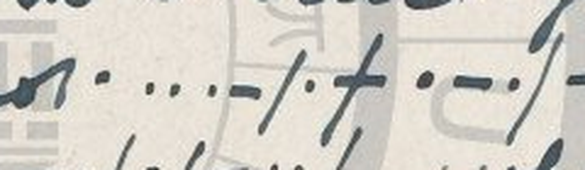

# HCP 1432 (pc_hcp_113): a Morse-code postcard from Louie, 12 August 1907

Human solver: Tomáš Pavuk

**Status: deciphered in full (42 of 42 Morse groups); three single-letter writer's slips are read from context and disclosed. Independent review 1 verdict REVISE; all five findings addressed, no change to the reading.** Report dated 2026-10-30.

## Origin and context

The cryptogram is record 1432 of the HC Portal (https://crypto.hcportal.eu/dashboard/cryptograms/1432), portal name pc_hcp_113, part of the HCPortal collection of cryptographic postcards (private collection). When it was captured on 2026-10-26 the portal listed it as **Not solved**, tagged Postcard, HCPortal collection and Morse code, category Substitution, date 1907-08-12, language Unknown, location Europe, sender Unknown, recipient G. Groves, with no transcription or solution attached.

It is a British picture postcard (publisher Langsdorff & Co., 19 City Road, London) whose picture side shows the falls at Virginia Water and carries no cipher. The address side is addressed **Mrs G. Groves, 90 Westbourne Rd, Barnsbury N.** (Islington, north London) and franked with a green stamp cancelled **TOTTENHAM, 11.15 AM, 12 AU 07**, so the card was posted in Tottenham on Monday 12 August 1907. The message occupies the left-hand "writing space" and is written upside down relative to the address; turned through 180°, it is an ordinary letter in English cursive into which several words are inserted in **Morse code**, written as pen dots and dashes. It is signed **Louie** in cursive.

A sister card, HCP 1433 (same addressee, 2 August 1907), is also written in pen Morse in the same style, and its Morse contains the name LOUIE (whether as the writer's signature or the addressee's pet name is left open there).


## Method

The Morse is written as dots and dashes, with every letter closed by a long slanted stroke (`/`); word boundaries are not marked. The solver turned the scan through 180°, located every run of Morse on the card (eight runs, 42 letter groups), and read each group on enlargements of 3–15×. Where the ink crosses the brown printed lettering of the card (POST CARD, LANGSDORFF) or the grey HCPortal watermark, colour and brightness measurements were used to separate the blue-black ink from the print. The groups were recorded in a literal transcript and decoded by a script with the standard International Morse alphabet. Nothing in the key is fitted to the card.

Earlier work on this card was done by an OpenAI GPT solver (GPT-6 Astra / GPT-6.1 Sol) on 2026-10-26: the portal capture, the orientation, the 42-group inventory, the readings KINDNESS ON SATURDAY / VERY TIRED / REA?HED HOME, and checks that no historical Morse variant gives C as `.-.-`. Claude Opus 5.5 completed it on 2026-10-29: it re-read every group, corrected the last Morse word (see below), and made the full claim. An independent Claude Opus 5.5 reviewer then read every group again from its own crops and decoded them with its own script; its reading was identical.

## Key

Standard International Morse code, letters A–Z only (no digits or punctuation occur):

| A `.-` | B `-...` | C `-.-.` | D `-..` | E `.` | F `..-.` | G `--.` |
|---|---|---|---|---|---|---|
| H `....` | I `..` | J `.---` | K `-.-` | L `.-..` | M `--` | N `-.` |
| O `---` | P `.--.` | Q `--.-` | R `.-.` | S `...` | T `-` | U `..-` |
| V `...-` | W `.--` | X `-..-` | Y `-.--` | Z `--..` | | |

## Transcript and plaintext

Literal transcript, one row per Morse run (`/` is the writer's letter-closing stroke; `(-)` is a dash through which the writer drew the closing stroke):

```text
thanks-1  -.- / .. / -.                                KIN
thanks-2  -.. / -. / . / ... / ... / --- / -. / ...    DNESSONS
thanks-3  .- / - / ..- / .-. / -.. / .- / -.--         ATURDAY
tired-1   ...- / .(-) / .-. / -.-- / - / ..            VARYTI   (read VERYTI)
tired-2   .-. / . / -..                                RED
home-1    .-. / . / .- / .-.- / .... / . / -.. / ....  REA{.-.-}HEDH (read REACHEDH)
home-2    --- / -- / .                                 OME
closing   - / -. / ..- / .                             TNUE     (read TRUE)
```

Decoded Morse words: **KINDNESS ON SATURDAY / VERY TIRED / REACHED HOME / TRUE**.

The whole card, with the Morse words in capitals in their places in the cursive letter (the cursive is plain writing, not cipher):

```text
My D. S. Thank you
dear for all your KINDNESS ON SATURDAY
evening I am A.1. this
a.m I trust you were
not VERY TIRED when you
REACHED HOME I am so
fearfully lazy. hope
you are well Your
TRUE Friend
Louie
```

English: **"My D. S., Thank you, dear, for all your kindness on Saturday evening. I am A1 (in fine form) this morning. I trust you were not very tired when you reached home. I am so fearfully lazy. Hope you are well. Your true friend, Louie."**

Slovak: **„Môj/moja D. S., ďakujem ti, drahá/drahý, za všetku tvoju láskavosť v sobotu večer. Dnes ráno som na tom výborne. Dúfam, že si nebol(a) veľmi unavený(á), keď si prišiel/prišla domov. Som taký(á) strašne lenivý(á). Dúfam, že sa máš dobre. Tvoj(a) verný(á) priateľ(ka) Louie.“**

Saturday before Monday 12 August 1907 was 10 August 1907.

## Reproduction

From the repository root:

```sh
python3 -I ciphers/hcp-1432/work/decode_full.py
```

The script uses only the Python standard library. It checks the SHA-256 hashes of the files in source/, decodes every group of work/transcription-full.txt literally with the standard alphabet, and then prints the reading with the three editorial letters in lower case. Its output ends:

```text
42 Morse groups, 1 non-alphabet group(s), 3 editorial reading(s):
LITERAL : KIN | DNESSONS | ATURDAY | VARYTI | RED | REA{.-.-}HEDH | OME | TNUE
  KINDNESSONSATURDAY / VeRYTIRED / REAcHEDHOME / TrUE
```

The transcription itself is manual; the script does not read the image.

## Uncertainties

39 of the 42 groups decode literally to the letters of the English words above. Three are single-letter slips by the writer; in each case the sentence fixes the intended word.

- **REACHED: `.-.-` for C.** The fourth group of REACHED is written dot, dash, dot, dash, which is not an International letter (in Continental Morse it is Ä). The writer reversed the elements of C (`-.-.`). The first dot is a heavy oval, larger than the other dots, but is still a dot; read as a dash it would give Q, no better. No historical Morse table gives C as `.-.-`, and no division of the group by a missing stroke gives C.
- **VERY: a crossed dash after the E.** After the dot of E the writer drew a full dash and then drew the letter-closing stroke straight through it, so that the mark looks like "†". Taken literally the group is `.-` (A), giving VARY. The dash was probably begun by mistake and struck out with the stroke; VERY is certain from "not very tired when you reached home". This mark was missed in the first claim and added after review.



- **TRUE: `-.` (N) for R.** The R of TRUE stands inside the bowl of the printed letter P of POST. On the pixels it is a short dash and a dot; where the leading dot of R would be, the bowl of the P is pure brown print with no ink. Either the writer dropped the dot or it is invisible on the print. "Your true friend" fixes the word, and the writer's four other R's are correct. (The earlier GPT transcript had `.-.` here; this was corrected on the pixels.)
- **Faint U in SATURDAY.** The pen runs almost dry here; the dash of U (`..-`) is a very faint band with a dark dot-sized end. Without the band the group would be S. The band is bluer than the grey watermark and horizontal, so it is read as a dash; SATURDAY confirms it.
- **A raised dot after "not"** stands above the line of the Morse and is larger than the Morse dots; it is taken as cursive punctuation, not a fifth element of V (which would make the digit 4).
- **Cursive readings.** The salutation initials ("D. S."), "A.1." and the signature "Louie" are ordinary handwriting readings, not cipher results. A faint, half-dry cursive scribble before the final Morse word ("…ue"-like, partly under the printed T and S) is not Morse and is not read; it may be a false start of "true". The sex and identity of writer and addressee are not established.
- No published solution of this card was found; the portal lists it as Not solved, and the AI Decipherment Register had no record of it on 2026-10-29.

## Review summary

Reviewer: Claude Opus 5.5 (Anthropic), a separate agent, round 1, verdict **REVISE**. The reviewer ran the reproduction command, made its own 180°-rotated crops of every Morse row at 3–14×, separated ink from print by colour, wrote its own transcript and its own decoder, and obtained the same 42 groups and the same reading. It confirmed both disclosed slips (`.-.-` for C and `-.` for R, including a pixel check of the P bowl showing no ink) and judged the text natural Edwardian English that fills the gaps of the cursive letter exactly. Its findings, and what changed:

1. **Crossed dash in VERY (major).** The transcript had claimed literal strokes but omitted a dash crossed by the closing stroke. It is now in the transcript as `.(-)`, decoded literally as A, and listed as a third editorial reading (E). The coverage statement changed from 40 to 39 literal groups.
2. **Address (minor).** The first claim gave the address as "90 West Green Rd(?), Tottenham". It is 90 Westbourne Rd, Barnsbury N.; Tottenham is only the posting office in the postmark. Corrected.
3. **Faint U dash in SATURDAY (minor).** Now disclosed.
4. **Heavy first dot of `.-.-` (minor).** Now described; conclusion unchanged.
5. **HCP 1433 cross-reference (minor).** Now notes that the role of LOUIE on that card is open.

No decoded word changed as a result of the review.

## Sources

- HC Portal record 1432, General, Description and Attachments tabs, captured 2026-10-26: https://crypto.hcportal.eu/dashboard/cryptograms/1432 (source/metadata.md).
- Address side: https://api.hcportal.eu/media/4357/conversions/pc_hcp_113_adr-large.jpg (source/address.jpg).
- Picture side: https://api.hcportal.eu/media/4356/conversions/pc_hcp_113_pic-large.jpg (source/picture.jpg).
- Morse references: Alfred Vail, *The American Electro Magnetic Telegraph* (1845), alphabet on p. 27; CCITT (1972), Recommendation F.1, Division B.
- AI Decipherment Register (https://ai.hcportal.eu/register/), checked 2026-10-29.
