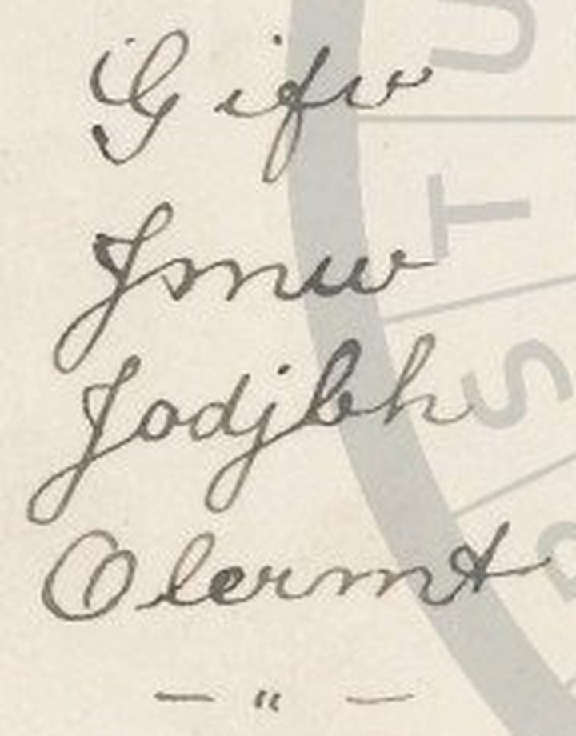

# HCP 1451 (pc_hcp_132): "True and always loving" in Atbash

Human solver: Tomáš Pavuk

**Status: deciphered in full (19 of 19 cipher letters); independent review 1 verdict ACCEPT, no change to the plaintext.** Report dated 2026-10-29.

## Origin and context

The cryptogram is record 1451 of the HC Portal (https://crypto.hcportal.eu/dashboard/cryptograms/1451), portal name pc_hcp_132, part of the HCPortal collection of cryptographic postcards (private collection). When it was captured on 2026-10-26 the portal listed it as **Not solved**, tagged Postcard, HCPortal collection, main category Unknown, language Unknown, date 1906-02-08, location Europe, sender Unknown, recipient L. Schuller, with no transcription or solution attached.

The address side is a British "Living Picture Series" postcard with a green halfpenny Edward VII stamp, cancelled at **St Albans, 8 Feb 1906**. The address is in plain writing: **Miss L. Schuller, "The Queens Arms", High Street, Berkhamsted, Herts.** The left half of the card, reserved for the message, carries four short handwritten lines in cipher, followed by a dash, a ditto-like double tick and another dash (closing marks, no letters). There is no signature. The picture side is a printed song card, "My Little Octoroon", with no handwriting.





## Method

The four lines were transcribed **manually** from enlarged (5x LANCZOS) crops of the address-side scan; no OCR was used and the portal supplied no transcription. Under the reversed alphabet (Atbash: A↔Z, B↔Y, C↔X, …) the first line, Gifv, gives TRUE; applying the same rule to all lines gives a complete English phrase.

The work was done in two stages. An earlier solver, OpenAI GPT (GPT-6 Astra), on 2026-10-26 identified Atbash and read lines 1 and 3 (TRUE, ALWAYS), but left line 2 unresolved (four-letter readings such as GRNV or GLNV, giving TIME or TOME) and read line 4 as OLEVMT, giving the non-word LOVENG. On 2026-10-29 Claude Opus 5.5 re-read the scan and completed the reading:

- **Line 2 has three letters, not four.** The first sign is the same J-shaped capital that opens line 3 (not the G of line 1); what had been read as a separate "n" is the second arch of an **m**; the last sign is a looped **w**. So the line is Zmw → AND.
- **Line 4, fourth sign, is a cursive r**, with a pointed shoulder running straight into the m, and without the closed top-right hook that the v at the end of line 1 has. So the line is Olermt → LOVING.

The key is a single fixed rule with no keyword; it is not fitted to the text, and it covers all 19 letters.

In review, a separate Claude Opus 5.5 agent made its own crops (4x to 9x), read every sign itself, and decoded with its own script. Its reading agreed in every position. As a control it also tried a 25-letter Atbash (I and J merged), which produces nonsense, confirming the standard 26-letter alphabet.

## Key

Atbash, letter for letter, keeping the writer's capitals and word divisions:

```text
plain : A B C D E F G H I J K L M N O P Q R S T U V W X Y Z
cipher: Z Y X W V U T S R Q P O N M L K J I H G F E D C B A
```

## Plaintext

| Line | As written | Normalised cipher | Plain |
|---|---|---|---|
| 1 | Gifv | Gifv | True |
| 2 | Jmw | Zmw | And |
| 3 | Jodjbh | Zodzbh | Always |
| 4 | Olermt | Olermt | Loving |

The writer forms every cipher **Z** like a J (see Uncertainties); the normalised column replaces these J/j shapes by Z/z.

English original: **True and always loving**

Slovak translation: **Verný a vždy milujúci** (or, from a woman, **Verná a vždy milujúca**)

It is a standard Edwardian closing phrase of a love letter or card, here standing alone without a name.

## Reproduction

From the repository root:

```sh
python3 -I ciphers/hcp-1451/work/decode.py
```

The script uses only the Python standard library. It checks the SHA-256 hashes of the files in source/, reads the manual transcription in work/transcription.json, checks that the as-written (diplomatic) form with J→Z equals the normalised form, decodes each line with Atbash, re-encodes it as a check, and prints `True And Always Loving` with `Source hashes OK; 19 cipher letters decoded.` It does not read the image; the transcription step is manual and was confirmed independently in review.

## Uncertainties

- **Z written as J.** All three cipher-Z positions are written in a J/j form: the capitals of lines 2 and 3 are J-shaped, and the fourth letter of line 3 is a clearly dotted lowercase j. Read literally, J under Atbash gives Q ("True Qnd Qlwqys Loving"), which is not language; read as Z it gives AND and ALWAYS. Because it happens at every Z (3 of 3), it is a systematic habit of the writer rather than a single slip. Whether the writer deliberately wrote J for Z or used a J-like form of z (and dotted it once) cannot be decided from one card. The plaintext is not affected.
- **Short text.** With only 19 letters no statistical test is meaningful; the evidence is that one fixed, keyless rule turns every letter into a natural English phrase.
- **Sender unknown.** The card is unsigned; the marks under the text carry no letters.
- No search for a prior publication of this card was made beyond the portal status (Not solved, no attachment) and the AI Decipherment Register (no entry for this record, checked 2026-10-29).

## Review summary

Reviewer: Claude Opus 5.5 (Anthropic), round 1, verdict **ACCEPT**. The reviewer ran the reproduction command (output identical to the claim), decoded its own transcription with its own Atbash script, checked every sign on its own 4x–9x crops (confirming three letters in line 2 and the r in line 4), checked that the picture side has no handwriting, and found no sign that a published solution had been used. Its three minor findings were all accepted:

- **Diplomatic transcription.** work/transcription.json now records the letters as written (Jmw, Jodjbh) next to the normalised Z forms, with J/j = Z stated as an interpretation; the decoder checks that the two agree.
- **Not a slip.** The J-for-Z writing is now described as systematic (3 of 3), not as an isolated writer's slip.
- **Line 2 letter count.** This report explains why the earlier four-letter reading was dropped (the "n" was the second arch of m).

No decoded letter changed as a result of the review.

## Sources

- HC Portal record 1451, General, Description and Attachments tabs, captured 2026-10-26: https://crypto.hcportal.eu/dashboard/cryptograms/1451 (source/metadata.md).
- Address side: https://api.hcportal.eu/media/4414/conversions/pc_hcp_132_adr-large.jpg (source/address.jpg).
- Picture side: https://api.hcportal.eu/media/4413/conversions/pc_hcp_132_pic-large.jpg (source/picture.jpg).
- AI Decipherment Register (https://ai.hcportal.eu/register/), checked 2026-10-29.
