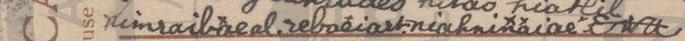

# HCP 1456 (pc_hcp_137): an English null-cipher postcard to Miss B. Evison, 1905

Human solver: Tomáš Pavuk

**Status: deciphered in full (all 49 cipher words read by one rule). Independent review 1 gave the verdict ACCEPT; the decoded text did not change.** Report dated 2026-10-30.

## Origin and context

The cryptogram is record 1456 of the HC Portal (https://crypto.hcportal.eu/dashboard/cryptograms/1456). Its portal name is pc_hcp_137, and it belongs to the HCPortal collection of cryptographic postcards (private collection). When it was captured on 2026-10-26 the portal listed it as **Not solved**: category Unknown, language Unknown, date 1905-03-18, location Europe, sender Unknown, recipient B. Evison. No transcription or solution was attached.

The picture side is a Bamforth card, "The Old Chorister (2)", with printed English verse and no handwriting. All the handwriting is on the address side. It is addressed in plain writing to **Miss B. Evison, Crown Hotel, Cowden, Kent**, and the postmark reads East Grinstead, 6 a.m., 18 March 1905. The message fills the left half of the card in sixteen lines of what looks like cursive gibberish. It is written sideways, so it has to be turned 90° to be read (work/reading.jpg).


## Method

On 2026-10-26 an OpenAI GPT solver (GPT-6 Astra) downloaded the sources and did an initial triage. It saw the long cursive text with many repeated short syllables and listed "false spacing or inserted letters" as an untested possibility. It made no transcription and found no key. On 2026-10-29/30 Claude Opus 5.5 transcribed the text by hand from 4–12× enlargements (no OCR) and found the rule.

The first word, `Nitchuavnikes`, gives the key. Drop its first two letters, then take every second letter: **t-h-a-n-k-s**. The same rule turns `nifaoyr` into *for*, `riyaoru` into *you*, `nothono` into *too*, `hiliarthe` into *late*, `natrhoe` into *the* and `nimuanial` into *mail*. Every cipher word has the form

`null null P1 null P2 null P3 …`

so each cipher word decrypts to `word[2::2]`. A word of even length ends with one extra trailing null. The nulls are arbitrary letters, mostly n, i, a, r and h. There is no substitution: the plaintext letters are written as themselves.

Five cipher words are split across a line break (tem|deraen = *mean*, gnpalae|hnatay = *plenty*, zah|iazrirry = *Harry*, zi|tioa = *to*, th-|tohaias = *this*). One has a space inside it (thmia znioar = *Manor*). One cipher word carries two plain words: `ariratm` = *I am*. `nadiornat` gives *dont* (don't), without an apostrophe. The writer's own full stops and question mark fall at the ends of sentences in the decoded text.

The reviewer, a separate Claude Opus 5.5 agent, made its own crops. It typed its own token list, with different guesses for several blotted null letters, and decoded it with its own script. Its output agreed letter for letter. It also checked all 49 words index by index: every plaintext letter sits at an even position (2, 4, 6, …) with no exception.

## Key

**Null cipher (letter interleaving).** Decryption rule for each cipher word: skip two letters, then keep the 3rd, 5th, 7th, … letters.

Examples:

| Cipher word | Kept letters | Plain |
|---|---|---|
| Ni**t**c**h**u**a**v**n**i**k**e**s** | t h a n k s | thanks |
| ra**t**h**o**r**n**a**i**h**g**r**h**a**t** | t o n i g h t | tonight |
| ya**r**a**e**h**g**i**a**k**r**a**d**e**s** | r e g a r d s | regards |
| ra**w**h**o**r**n**a**d**a**e**k**r** | w o n d e r | wonder |
| ni**a**r**b**i**o**a**u**r**t** | a b o u t | about |
| zi**w**h**r**a**i**a**t**a**e** | w r i t e | write |

## Transcription

The upright card, line by line. `=` marks a word the writer continued on the next line without a hyphen, and `th-` keeps the writer's own hyphen. `+` joins two pieces of one cipher word that the writer separated with a space.

```text
Nitchuavnikes nifaoyr tiyhoauir
nawkhiart nadio riyaoru tem=
deraen . ranao prsrtiarmkt
ariratm nothono hiliarthe
rafiour natrhoe nimuanial
rathornaihgrhat nagiort
pahaormae raforoorm nawhoarak
hiart zinaianhe hablcalaorcak . gnpalae=
hnatay raouf hawaohrak niarbioaurt
rahaerrae . rawhornadaekr nawrhiy zah=
iazrirry nadiornat ziwhraiatae zi=
tioa yamae . nahiarvae nabseaetn
hoart nifaohrad thmia+znioar th-
tohaias niwaeaeok ? nikhirnrd
yaraehgiakrades kitao hiatlil
nimraibreal . rebaeiart . niahninaiae      [Ewtt]
```

## Plaintext

Raw decode, one group per cipher word:

```text
thanks for your what do you mean . no stamt iam too late for the mail
tonight got home from work at nine bclock . plenty of work about here .
wonder why harry dont write to me . have been at ford manor this week ?
kind regards to all mabel . beat . annie
```

Normalised English (punctuation and the bracketed words are editorial):

**Thanks for your [card?]. What do you mean? No stamp [card has "stamt"]; I am too late for the mail tonight. Got home from work at nine o'clock [card has "bclock"]. Plenty of work about here. [I] wonder why Harry don't write to me. Have [you] been at Ford Manor this week? Kind regards to all. Mabel. Beat. Annie.**

The plaintext is in English, so the text above is also its English version.

Slovak translation: **Ďakujem za tvoj(u) [pohľadnicu?]. Čo tým myslíš? Žiadna známka; dnes večer už nestihnem poštu. Prišla som domov z práce o deviatej. Je tu veľa roboty. Čudujem sa, prečo mi Harry nepíše. Bola si tento týždeň vo Ford Manor? Srdečné pozdravy všetkým. Mabel. Beat. Annie.**

Notes on the reading:

- **Context.** The card was posted at East Grinstead (Sussex) to Cowden (Kent). Ford Manor, near Dormansland and Lingfield (Surrey), lies a few miles from both. "Too late for the mail tonight" fits a card that was posted in the evening and postmarked at 6 a.m. the next morning.
- **Colloquial grammar.** "Harry don't write" is ordinary colloquial English of the time. The missing pronouns ("[I] wonder", "Have [you] been") are missing from the cipher itself, not lost in decryption.
- **The closing names.** "Kind regards to all. Mabel. Beat. Annie." can be read in two ways. Mabel, Beat (probably Beatrice) and Annie may be three senders who signed together. Or "all" may be Mabel, Beat and Annie, the people being greeted. The addressee is Miss **B.** Evison, which makes "Beat" an odd name for a co-sender and supports the second reading. The card does not decide between them, and the sender is not known.



## Uncertainties

1. **"stamt".** The cipher word `prsrtiarmkt` reads clearly as p r s r t i a r m k t, and the final letter is a crossed t, not a p. The rule gives *stamt*, which is not a word. The likely meaning is "stamp", with the writer slipping on the last plain letter. "Start" is a less likely alternative. The literal decode is kept.
2. **"bclock" for o'clock.** The third letter of `hablcalaorcak` is a clear looped b, so the literal decode is *bclock*. The sense, "nine o'clock", is not in doubt. The letter at position 9 has an o-bowl. A stroke below it looks like the tail of a p, but it is the ascender of the final k of `hawaohrak` in the next line. So the letter is read as o, from both its shape and the context.
3. **"Thanks for your …".** No noun follows "your". The writer seems to have left out "card" or "letter".
4. **Blotted and retraced words.** `rahaerrae` (here), `zah|iazrirry` (Harry), `yamae` (me) and `hoart` (at) are partly retraced or blotted. The plaintext letters at the even positions can be read. Some null letters cannot be read with certainty, but nulls never affect the plaintext.
5. **Line order of lines 7–8.** The lines slope steeply. They were put in order by following the baselines, which gives "got home from work at nine o'clock". The other possible order, "got home at nine o'clock from work", means the same.
6. **Marks over the last line.** Small x-shaped marks stand over the three names, two of them stacked over `niahninaiae`. They are probably the usual postcard kisses and are not part of the cipher.
7. **"Ewtt".** A larger flourish follows the last word. The rule would turn it into a single t. It is reported literally and may be initials or a flourish; whether it carries any meaning is not established.
8. **Identities.** Miss B. Evison, Harry, Mabel, Beat, Annie and the writer have not been identified.

## Review summary

Reviewer: Claude Opus 5.5 (Anthropic), a separate agent. Round 1, verdict **ACCEPT**.

The reviewer:

- ran the reproduction command and got output identical to the claimed plaintext;
- decoded its own independent transcription and got the same letters;
- checked every one of the 49 cipher words index by index;
- checked the difficult words on 6–8× crops of the scan.

It confirmed the honest literal readings "stamt" and "bclock", the split words, the fit with the local geography, and that the portal holds no published solution.

Its five minor findings, and what was done about each:

- **Index-8 letter of `hablcalaorcak`.** The p-like stroke belongs to the **k** of the next line, not the h. The wording was corrected; the letter is still o.
- **Marks over the last line.** These are x-crosses, probably kisses, and are now described that way rather than as decorative breves.
- **Closing names.** The report now gives both readings (three signatures, or the people greeted) and does not name the sender.
- **Typo in the decoder's check string** ("for d manor"). Fixed. The check compares letters only, so the output did not change.
- **"your" at the line end.** No change was needed; the missing noun was already disclosed.

No decoded letter changed as a result of the review.

## Reproduction

From the repository root:

```sh
python3 -I ciphers/hcp-1456/work/decode.py
```

The script uses only the Python standard library. It:

- checks the SHA-256 hashes of the two scans and the metadata;
- reads the manual transcription in work/transcription.txt and joins the split words;
- applies `word[2::2]` to every cipher word;
- asserts that the result equals the expected letter string;
- prints the raw decode and the readable plaintext.

The transcription itself is manual.

## Credits

- Source capture and initial triage, 2026-10-26: OpenAI GPT (GPT-6 Astra).
- Transcription, decipherment, report and closing, 2026-10-29/30: Claude Opus 5.5.
- Independent review: a separate Claude Opus 5.5 agent.
- No published solution of this card was found or used.

## Sources

- HC Portal record 1456, General, Description and Attachments tabs, captured 2026-10-26: https://crypto.hcportal.eu/dashboard/cryptograms/1456 (source/metadata.md).
- Address side: https://api.hcportal.eu/media/4429/conversions/pc_hcp_137_adr-large.jpg (source/address-large.jpg).
- Picture side: https://api.hcportal.eu/media/4428/conversions/pc_hcp_137_pic-large.jpg (source/picture-large.jpg).
- AI Decipherment Register (https://ai.hcportal.eu/register/), checked 2026-10-29: no entry for this card.
