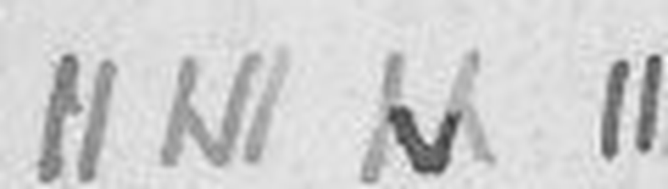

# HCP 1457 (pc_hcp_138): a Morse and pig-Latin postcard from Falmouth, 6 March 1903

Human solver: Tomáš Pavuk

**Status: all cipher text on the card is deciphered (93 Morse letters on the address side, 15 pig-Latin tokens in the picture-side margin). Independent review 1 gave the verdict ACCEPT and the decoded text did not change.** Two letters of the Morse text and one letter of the margin are context restorations; they are listed under Uncertainties. Report dated 2026-10-30.

## Origin and context

The cryptogram is record 1457 of the HC Portal (https://crypto.hcportal.eu/dashboard/cryptograms/1457). Its portal name is pc_hcp_138, and it belongs to the HCPortal collection of cryptographic postcards (private collection). When it was captured on 2026-10-26 the portal listed it as **Not solved**. It was tagged Postcard, HCPortal collection, with category Substitution; Monoalphabetic, date 1903-03-06, language Unknown, location Europe, sender Unknown and recipient E. E. Edwards. No transcription or solution was attached, and no published solution of this card was found.

The address side is a British halfpenny postcard postmarked **FALMOUTH, MR 6 03** (6 March 1903). It is addressed in plain writing to *Miss E. E. Edwards, 4 Hatham(?) Road, Holloway, London N.* The left half carries nine lines of short and tall pen strokes, some joined into check marks and λ-like shapes. This is the main cipher.


The picture side shows "Carrying the Caul," Cornwall (Argall's Series). Two lines of ordinary-looking cursive run along one edge, upside down relative to the caption. The portal noted them as plain cursive that had not been transcribed. They are in fact a second, simpler disguise, a variant of pig Latin.


## Method

**Address side.** The strokes come in two heights, and the number of strokes per group runs from one to four. That is the pattern of Morse code. The test was the first line. Reading a tall stroke as a dash and a short stroke as a dot, the groups `... --- .-. .-. -.-- / -.-- --- ..-` give SORRY YOU. The same rule was then applied to every line, and all nine lines decode to English with no leftover group. No key was fitted to the text: the table is the standard International Morse alphabet.

Strokes of one letter are usually joined in a single pen movement, and the joined shapes are split into strokes:

| Written shape | Strokes | Letter |
|---|---|---|
| short stroke | . | E |
| tall stroke | - | T |
| check mark (short down, tall up) | .- | A |
| λ-like sign (tall, short at the foot) | -. | N |
| short–tall–short joined (ʎ) | .-. | R |
| 2 / 3 / 4 short strokes | .. / ... / .... | I / S / H |
| 2 / 3 tall strokes | -- / --- | M / O |

Small gaps separate letters and larger gaps separate words. A slanted dash followed by a dot (at the ends of lines 4 and 7) and a single dot (at the end of line 9) are full stops, not letters.


The transcription was made by hand from enlarged crops (3–8×) of the scan. It is stored one Morse group per letter in `work/transcription-morse.txt`.

**Picture-side margin.** Read upright, the words look like English with the wrong beginnings: *Anyma ankstha orfa P.C. …*. Moving the final consonant group back to the front and dropping the final *a* gives *many thanks for P.C.* The rule is: the initial consonant or cluster of each word moves to the end, followed by **-a** (the common form of pig Latin adds *-ay*). *Before* is enciphered syllable by syllable: *be* becomes *eba* and *fore* becomes *orefa*, written "eba-orefa". "P.C." is in clear.


Both transcriptions are by Claude Opus 5.5. The portal supplied none.

## Key

- **Address side:** standard International Morse code, written with **tall stroke = dash, short stroke = dot**.
- **Margin:** pig-Latin variant, *onset + a* moved to the end of each word (syllable by syllable in *before*).

## Plaintext

### Address side (Morse)

Stroke transcription and decoding, line by line:

```text
L1: .- -- / ... --- .-. .-. -.-- / -.-- --- ..-                  AM SORRY YOU
L2: .... .- -.. / ... ..- -.-. .... / .- / ..-. .. -            HAD SUCH A FIT
L3: --- ..-. / - .... . / --. .-. ..- -- -... .-.. . ...         OF THE GRUMBLES
L4: .... --- .--. . / -... . - - . .-. / -. --- .-- STOP        HOPE BETTER NOW.
L5: -- -.-- / -.-. --- .-.. -.. / .-. .- - .... . .-.            MY COLD RATHER
L6: -... .- -.. / - --- -.. .- -.-- / -. .- ... - -.--          BAD TODAY NASTY
L7: -.-. --- ..- --. .... STOP                                   COUGH.
L8: .... . .- .--. ... / --- ..-. / .-.. --- ...- .              HEAPS OF LOVE
L9: .. .-.. .-.. .. . STOP                                       ILLIE.
```

Literal decoded text, with only the stops that are on the card:

```text
AM SORRY YOU HAD SUCH A FIT OF THE GRUMBLES HOPE BETTER NOW.
MY COLD RATHER BAD TODAY NASTY COUGH. HEAPS OF LOVE ILLIE.
```

### Picture-side margin (pig Latin)

Literal reading, then the decoded words. Punctuation is as on the card, and [y] is a restored letter:

```text
M1: Anyma ankstha orfa P.C. istha orningma. Aveha
M2: Ou[y]a eensa attha iewva eba-orefa. Ery va ettypra.

    Many thanks for P.C. this morning. Have
    you seen that view before. Very pretty.
```

### Translation

The card was presumably meant to be read margin first (a reply to the card received), then the Morse text. The sentence breaks after GRUMBLES and TODAY and the question mark after "before" are editorial.

**English (normalised):** Many thanks for the postcard this morning. Have you seen that view before? Very pretty. I am sorry you had such a fit of the grumbles; I hope you are better now. My cold is rather bad today – a nasty cough. Heaps of love, Illie.

**Slovak:** Veľká vďaka za pohľadnicu dnes ráno. Videla si už tento výhľad? Veľmi pekný. Je mi ľúto, že si mala taký záchvat mrzutosti; dúfam, že ti je už lepšie. Moja nádcha je dnes dosť zlá – škaredý kašeľ. Kopu lásky, Illie.

The text is idiomatic Edwardian postcard English. The subject is left out ("Am sorry…", "Hope better now"), and the closing is "Heaps of love". It fits the card: a friend who has had "a fit of the grumbles", a cold and cough in Cornwall in early March, and a comment on the Cornish view printed on the front.

## Reproduction

From the repository root:

```text
python3 -I ciphers/hcp-1457/work/decode.py
```

The script checks the SHA-256 hashes of both scans in `source/`. It then decodes `work/transcription-morse.txt` with the standard Morse table and `work/transcription-margin.txt` with the pig-Latin rule, and prints both plaintexts. In review, a separate script with its own Morse table (review/work/indep.py) gave the same 93 letters, and a forward pig-Latin encoder (review/work/pigcheck.py) reproduced every margin word.

## Uncertainties

1. **C of COLD (line 5) is a correction, and C is restored from context.** The sign is a light inverted V (two tall strokes) with a dark short V written over its middle. The order of the strokes cannot be read from the pixels, so it fits `-..-` (X) as well as `-.-.` (C). Only the context "MY ?OLD RATHER BAD TODAY. NASTY COUGH" makes it C. This is the weakest letter on the card.
2. **Y of MY (line 5) breaks the tall/short rule.** The group is an N-shape (tall – diagonal – tall) followed by a separate tall stroke. The diagonal runs almost the full height, yet it has to count as a dot to give `-.--` = Y. Read literally, the strokes give no sensible letter. MY is a reading from context.
3. **AM (line 1)** could be grouped as a single letter `.---` = J, because the gap between the check mark and the two tall strokes is small. Only AM makes sense.
4. **Signature ILLIE** is read exactly as written (`.. .-.. .-.. .. .`), with two clear short strokes at the start. It may be a pet name or a slip for Lillie or Ellie. Nothing is restored, and the sender is not identified.
5. **Margin "Ou[y]a" (you).** The middle letter lies under the long descender of the *y* of "Anyma" in the line above and cannot be seen on its own. *y* is restored as the only letter that gives *you*.
6. **Margin, small points:** the second letter of *aveha* looks like r or v, the minims of *eensa* are crowded, *Ery va* is written with a gap, and the last letter of *ettypra* could be a or e. The meaning does not depend on any of them.
7. The clear address ("4 Hatham(?) Road") is only roughly read and is not part of the cipher.



Only the portal's 1024×674 scans were available. A higher-resolution scan might settle the stroke order of the corrected C.

## Review summary

An independent reviewer (a separate Claude Opus 5.5 agent) tried to refute the solution. It re-ran the reproduction command, decoded the Morse transcription with its own table, re-read every line of both sides from its own crops at 3–8× without consulting the solver's crops, and re-encoded the claimed English margin text forward into pig Latin. It found the same 93 Morse letters and agreement on all margin tokens. It judged the text real Edwardian English that fits the date, place and picture, and found no use of a published solution. Verdict: **ACCEPT**, with five minor findings:

1. The C of COLD cannot be read from the pixels and is restored from context. It is now stated that way in this report.
2. The Y of MY needs a full-height diagonal to count as a dot. The disclosure is kept.
3. The margin [y] is a restoration. It was already marked, and nothing changed.
4. The literal text should be shown separately from the normalised translation. This report now does so.
5. The type should be given as Morse code plus pig Latin in English, not the portal's "Substitution; Monoalphabetic, Unknown". The report and register entry use the corrected type.

No letter of the reading changed after review.

## Credit and sources

- Source capture (scans, metadata) and a first triage on 2026-10-26: OpenAI GPT solver (GPT-6 Astra / GPT-6.1 Sol). It noted the tall/short strokes and mentioned Morse only as an untested analogy. It produced no reading.
- Identification of both systems, transcription of both sides, decipherment and decoder script: Claude Opus 5.5, 2026-10-30.
- Independent review: a separate Claude Opus 5.5 agent, 2026-10-30.
- Scans: https://api.hcportal.eu/media/4432/conversions/pc_hcp_138_adr-large.jpg (address side) and https://api.hcportal.eu/media/4431/conversions/pc_hcp_138_pic-large.jpg (picture side), via the portal page above.
