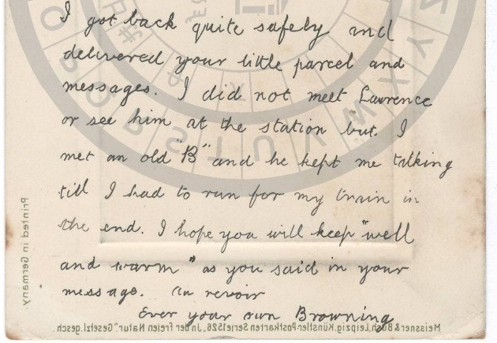

# HCP 1491 (pc_hcp_172): a mirror-written postcard to Wood Green, 1909

Human solver: Tomáš Pavuk

**Status: solved, accepted in independent review 1 (2026-10-26).** The whole handwritten message is English cursive written in mirror image and turned 90° on the card. One fixed geometric transform makes it legible; the reading is manual.

## Origin and context

The card is item 1491 of the HCPortal cryptographic postcard collection (`pc_hcp_172`, private collection), https://crypto.hcportal.eu/dashboard/cryptograms/1491. The portal gives the date 1909-01-18, region Europe, language Unknown, sender Unknown, recipient "Frances Mandy", and the cipher tag "Transposition". At acquisition (2026-10-26) the portal status was **Not solved**, with no attached transcription or solution.

The address side reads, in ordinary handwriting, **Miss Frances Mantz, Home & Colonial College, Wood Green, N.** The surname on the card is Mantz (a crossed t and a long-tailed z); the portal's "Mandy" appears to be a misreading. The Home & Colonial (Training) College in Wood Green, north London, trained teachers, so the addressee was probably a student there. The ½d Edward VII stamp is cancelled VICTORIA DOCKS (London E.), 3.15 PM, ·A 18, 09: day and year agree with the portal date; the month is only partly legible. The publisher line (Meissner & Buch, Leipzig) and "Printed in Germany" are printed normally. The picture side is a painted landscape with no handwriting.


## Method

The message block on the left half is written at right angles to the address and its letters are reversed. Rotating the scan 270° clockwise and then reflecting it horizontally turns it into normal left-to-right cursive. After the transform the printed publisher line becomes mirrored, which confirms that only the handwriting was reversed. The text was then read by hand from the transformed image and enlarged crops. No OCR was used, and no key was fitted to the text.



## Key

There is no substitution key. The "key" is a geometric transform: **rotate 270° clockwise, then mirror horizontally.** The portal tag "Transposition" does not describe this card; the type is mirror writing.

## Plaintext

As written on the card, with its line breaks:

```
I got back quite safely and
delivered your little parcel and
messages. I did not meet Lawrence
or see him at the station but I
met an old "B" and he kept me talking
til I had to run for my train in
the end. I hope you will keep "well
and warm" as you said in your
message. Au revoir
Ever your own Browning
```

Normalized English: "I got back quite safely and delivered your little parcel and messages. I did not meet Lawrence or see him at the station, but I met an old 'B' and he kept me talking till I had to run for my train in the end. I hope you will keep 'well and warm', as you said in your message. Au revoir. Ever your own Browning."

Slovak translation: „Vrátil som sa celkom bezpečne a doručil som tvoj balíček aj odkazy. Lawrencea som nestretol ani nevidel na stanici, ale stretol som starého ‚B‘ a ten ma zdržal rozhovorom, až som napokon musel utekať na vlak. Dúfam, že zostaneš ‚zdravá a v teple‘, ako si napísala vo svojom odkaze. Dovidenia. Navždy tvoj Browning.“ The writer's gender is a translation convention, not an established fact.

## Reproduction

From the repository root (the output path is optional; without it the script writes to /tmp/hcp-1491-decoded.png):

```
python3 -I ciphers/hcp-1491/work/decode.py /tmp/hcp-1491-decoded.png
```

The script checks the SHA-256 hashes of the files in `source/`, applies the rotate-and-mirror transform to `source/address-large.jpg` with `sips` (macOS), and prints the manual reading from `work/plaintext.txt` (234 letters). It does not read text from the image. The reviewer confirmed that its output image is byte-identical to `work/decoded.png`, which is the evidence image for the reading.

## Uncertainties

- `til` is read literally (t, dotted i, one looped ascender). A second l could be lost in a cramped loop at this resolution; normalized "till" is an edition.
- Punctuation and the placement of quotation marks are a reading of the hand; capitalization is conventional. No full stop is visible after "Browning".
- "Lawrence", the quoted "B" and the signature "Browning" are readings; none is identified with a historical person. "B" is not expanded. Browning may be a surname, nickname or pet name.
- The postmark month is only partly legible (·A; JA fits).
- Absence from the register snapshot does not prove that no decipherment was published elsewhere.

## Review summary

Reviewer: Claude Opus 5.5, round 1, verdict **ACCEPT**. The reviewer reran the command, made an independent transform with `sips`, read the message line by line from their own crops and matched the solver's reading word for word. Findings, all minor:

- Addressee surname is Mantz, not Mandy: corrected in this report and in `SOLUTION.md`; the portal value is noted as differing.
- Cipher type: reported as mirror writing, not the portal's "Transposition".
- `til`: kept, and listed as a reading judgement above.
- Default output path of the script: this report names `work/decoded.png` as the evidence image and shows an explicit output path.

The plaintext did not change. The closing steps (response to the review, this report and the register entry) were prepared by Claude Opus 5.5 on the solver's behalf at the human's request.

## Sources

- Portal page: https://crypto.hcportal.eu/dashboard/cryptograms/1491 (General, Description and Attachments tabs, read 2026-10-26).
- Address side: https://api.hcportal.eu/media/4534/conversions/pc_hcp_172_adr-large.jpg (`source/address-large.jpg`).
- Picture side: https://api.hcportal.eu/media/4533/conversions/pc_hcp_172_pic-large.jpg (`source/picture-large.jpg`).
- AI Decipherment Register snapshot: https://ai.hcportal.eu/register/?format=json (`work/register-snapshot.json`); no entry for this card. No published solution was used.
