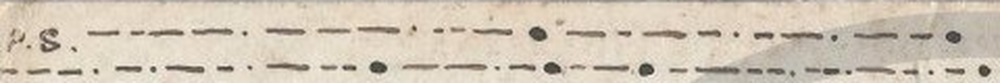

# HCP 1501 (pc_hcp_182): a Morse-code love letter from George to Nell, 1911

Human solver: Tomáš Pavuk

**Status: deciphered in full (33 of 33 lines, 265 of 265 Morse groups, none invalid); independent review 1 verdict ACCEPT, no change to the decoded letters.** Report dated 2026-10-30.

## Origin and context

The cryptogram is record 1501 of the HC Portal (https://crypto.hcportal.eu/dashboard/cryptograms/1501), portal name pc_hcp_182, part of the HCPortal collection of cryptographic postcards (private collection). When it was captured on 2026-10-26 the portal listed it as **Not solved**, tagged Postcard, HCPortal collection, category Unknown, date 1911-03-02, language Unknown, location Europe, sender Unknown, recipient O. Davy, with no transcription or solution attached.

It is an English picture postcard (picture side: Barnard Castle; printer's line "Printed in Saxony"). The picture side carries no cipher. The address side is addressed in plain writing to **Miss O. Davy, Gilberdyke, E. Yorks**. It is dated in plain "March 1st 1911" and has a green halfpenny stamp cancelled **BROUGH S.O. 8.15 PM MR 2 11 YORKS** (dispatch) and an arrival postmark **GILBERDYKE R.S.O. 6 AM MR 3 11 YORKS**. Brough and Gilberdyke are neighbouring villages in the East Riding of Yorkshire, a few miles apart.

The left half of the address side, and a band across the top above the date, is filled with 33 lines of dashes and dots drawn with a pen. A plain "P.S." stands at the very top left.




## Method

The marks on the card are of four kinds. Measured on the 1024 px portal scan (dark-pixel components of the red channel, which suppresses the red printing and the red ruled line) they are:

- short horizontal dashes, typically 5-11 px long;
- long horizontal dashes, typically 16-27 px long;
- small round ink dots, 2-4 px;
- large heavy round blobs, 6-10 px.

The key observation is that the visible **round dots are not Morse dots**. They are separators: a small dot ends a letter, a large blob ends a word. The Morse *dot* is the **short dash** and the Morse *dash* is the **long dash**. Read that way, the first line gives at once `-.-- --- ..- / -.-. .- -. /` = YOU CAN, the first line under the date gives DEAR NELL, and every one of the 33 lines then decodes to English.

The transcription was made by hand, line by line, from 5-8x enlargements of the scan; the automatic measurements served only as an aid, because they break dashes that are crossed by the grey HCPortal watermark, the red ruled line or the postmark circles. Dash length varies from line to line (dots about 5-14 px, dashes about 13-27 px over the whole card), so each mark was classified **relative to the other marks on its own line**, not against one fixed threshold. About twenty marks of intermediate length (12-16 px) were settled this way; in almost every case the word also requires the reading chosen. The one case where the pixels point the other way is the E in SWETHEART (see Uncertainties).

Words run over line ends (Y|OU, KN|OW, S|UNDAY, MI|GHT, TI|LL, WI|TH, AL|WAYS, DEAR|EST). Physically, lines 1-8 (above the date, starting with the plain "P.S.") are the postscript, and lines 9-33 are the letter.

## Key

There is no secret key: the code is standard **International Morse**. Only letters occur, no digits or punctuation.

| Plain | Morse | Plain | Morse | Plain | Morse | Plain | Morse |
|---|---|---|---|---|---|---|---|
| A | .- | H | .... | N | -. | T | - |
| B | -... | I | .. | O | --- | U | ..- |
| C | -.-. | J | .--- | P | .--. | V | ...- |
| D | -.. | K | -.- | R | .-. | W | .-- |
| E | . | L | .-.. | S | ... | Y | -.-- |
| F | ..-. | M | -- | G | --. | | |

Notation used below: `.` = short dash on the card, `-` = long dash, a space = small separator dot, `/` = large blob. Letters Q, X and Z do not occur.

## Plaintext

Transcription and decoding, line by line in physical order:

```text
L01 -.-- --- ..- / -.-. .- -. /                 YOU CAN
L02 ... . -. -.. / -- . / .- / .-.. .. -. . /   SEND ME A LINE
L03 -... .- -.-. -.- / .. ..-. / -.--           BACK IF Y
L04 --- ..- / .-.. .. -.- . /                   OU LIKE
L05 .. - ... / .- / .-.. ---                    ITS A LO
L06 -. --. / .-- . . -.- /                      NG WEEK
L07 -.-- --- ..- / -.- -.                       YOU KN
L08 --- .-- /                                   OW
L09 -.. . .- .-. / -. . .-.. .-.. /             DEAR NELL
L10 .--- ..- ... - / .- / .-.. .. -. . /        JUST A LINE
L11 - --- / .-.. . - / -.-- --- ..- /           TO LET YOU
L12 -.- -. --- .-- / - .... .- - /              KNOW THAT
L13 .. / .- -- / ... - .. .-.. .-.. /           I AM STILL
L14 .- .-.. .. ...- . / .- -. -.. /             ALIVE AND
L15 -.- .. -.-. -.- .. -. --. /                 KICKING
L16 .... --- .--. . / -.-- ---                  HOPE YO
L17 ..- / .- .-. . / - .... . / ... .- -- . /   U ARE THE SAME
L18 .. / .... .- -.. / .- / .-.. . - - . .-. /  I HAD A LETTER
L19 ..-. .-. --- -- / . / .--- . .-- .. - /     FROM E JEWIT
L20 --- -. / -- --- -. -.. .- -.-- /            ON MONDAY
L21 .. / .-- .. .-.. .-.. / ... .... --- .-- /  I WILL SHOW
L22 -.-- --- ..- / .. - / --- -. / ...          YOU IT ON S
L23 ..- -. -.. .- -.-- / .. - / -- ..           UNDAY IT MI
L24 --. .... - / .. -. - . .-. . ... - /        GHT INTEREST
L25 -.-- --- ..- / .-- . .-.. .-.. /            YOU WELL
L26 ... --- / .-.. --- -. --. / - ..            SO LONG TI
L27 .-.. .-.. / ... ..- -. -.. .- -.-- /        LL SUNDAY
L28 ... .-- . - .... . .- .-. - / .-- ..        SWETHEART WI
L29 - .... / -... . ... - / .-.. --- ...- . /   TH BEST LOVE
L30 .- -. -.. / -.- .. ... ... . ... /          AND KISSES
L31 -.-- --- ..- .-. ... / .- .-..              YOURS AL
L32 .-- .- -.-- ... / -.. . .- .-.              WAYS DEAR
L33 . ... - / --. . --- .-. --. . /             EST GEORGE
```

Literal decoded text, in reading order (letter first, then the postscript at the top of the card):

```text
DEAR NELL JUST A LINE TO LET YOU KNOW THAT I AM STILL ALIVE AND KICKING
HOPE YOU ARE THE SAME I HAD A LETTER FROM E JEWIT ON MONDAY I WILL SHOW
YOU IT ON SUNDAY IT MIGHT INTEREST YOU WELL SO LONG TILL SUNDAY SWETHEART
WITH BEST LOVE AND KISSES YOURS ALWAYS DEAREST GEORGE

P.S. YOU CAN SEND ME A LINE BACK IF YOU LIKE ITS A LONG WEEK YOU KNOW
```

English (the original language), edited: punctuation added, the writer's spelling kept; "(e)" marks a letter the writer left out, "[e?]" a letter read from context:

**Dear Nell, just a line to let you know that I am still alive and kicking, hope you are the same. I had a letter from E. (or T.) Jewit on Monday; I will show you it on Sunday, it might interest you. Well, so long till Sunday, swe(e)th[e?]art. With best love and kisses, yours always, dearest George.**

**P.S. You can send me a line back if you like, it's a long week you know.**

Slovak translation:

**Milá Nell, len pár riadkov, aby si vedela, že som stále živý a zdravý (doslova „žijem a kopem“), dúfam, že aj ty. V pondelok som dostal list od E. (alebo T.) Jewita; v nedeľu ti ho ukážem, mohol by ťa zaujímať. Nuž, tak zatiaľ do nedele, zlatko. S najvrúcnejšou láskou a bozkami, navždy tvoj, najdrahší George.**

**P.S. Ak chceš, môžeš mi napísať pár riadkov naspäť, veď vieš, týždeň je dlhý.**

Notes on the reading:

- "Alive and kicking", "just a line to let you know", "so long till Sunday" and "yours always" are ordinary colloquial English of the period. The Sunday-to-Sunday rhythm ("it's a long week") suits a weekly courtship between two neighbouring villages.
- The salutation is "Nell", while the card is addressed to Miss O. Davy; "Nell" may be a pet name. The Morse `-. . .-.. .-..` is unambiguous.
- "Hope you are the same" has no "I" before it: line 16 begins directly with the four short marks of H (checked on an enlargement).

## Reproduction

From the repository root:

```sh
python3 -I ciphers/hcp-1501/work/decode.py
```

The script uses only the Python standard library and writes no files. It checks the SHA-256 hashes of both scans, the metadata and the transcription (work/transcription.txt), decodes the 33 transcribed lines with the standard Morse table (an invalid group would stop it with an error), and prints every line followed by the letter and the postscript as above. It does not read the image; the transcription step is manual and was checked independently in review.

## Uncertainties

- **SWETHEART, the E after H (line 28).** This mark is 16 px long; on that line the dots are 6-10 px and the dashes 17-24 px, so by length alone it is nearer a dash, which would make it T ("SWETHTART"). It is read as E only because that gives a word. Treat this one letter as a context reading. The missing second E of "sweetheart" is the writer's own.
- **The initial in "E. Jewit" (line 19).** A single 12 px mark standing alone between two word blobs, crossed by a watermark stroke. Compared with the line's dots (6-10 px) and dashes (16-25 px) it is read as a dot, E; T is possible, and context cannot decide. The surname is clearly `.--- . .-- .. -` = JEWIT with one T, perhaps a misspelling of the East Riding surname Jewitt.
- **Separator in LOVE (line 29).** A 5×3 px mark just after the O is taken as a letter separator, giving V (`...-`); without it the group would be `....-`, the digit 4, which gives no word.
- **Intermediate dash lengths.** About twenty marks of 12-16 px were classified relative to their own line (listed in SOLUTION.md); all of them are confirmed by the words they form, except the SWETHEART E above.
- **Marks crossed by other ink.** Some dashes are partly crossed by the red ruled line, the postmark circle, the watermark or blots (in lines 10, 11, 12, 15, 17, 18, 20, 22, 23, 27 and 29). All are still visible on enlargement; none is a restoration.
- The identities of "Nell" / Miss O. Davy, of "George" and of E. Jewit are not established. Only the 1024 px portal scan was available, not the physical card.
- No prior publication of this reading was found: the portal status was Not solved with no solution attached, and the AI Decipherment Register had no record for this card (checked 2026-10-29).

## Review summary

Reviewer: Claude Opus 5.5 (Anthropic), a separate agent, round 1, verdict **ACCEPT**. The reviewer ran the reproduction command (output identical to the claimed plaintext), decoded the transcription with its own Morse table (265 groups, 0 invalid, identical text), measured the marks with its own scripts and an automatic classifier (exact agreement on several lines, differences only where marks are broken by the watermark, the red rule or the postmark), and checked ten lines mark by mark on 4-10x enlargements. It confirmed the postmarks, the date and the address, and found the English natural and coherent across line breaks. Its five findings were all minor:

- **SWETHEART E only a context reading.** Now flagged in the transcription file and marked "[e?]" in the edited text and in this report.
- **E/T initial of Jewit.** Kept as disclosed; the edited text gives "E. (or T.) Jewit".
- **Separator in LOVE.** Kept, flagged in the transcription.
- **Intermediate dash lengths.** The relative, per-line reading is now explained in the Method section.
- **Type label.** The type is International Morse code; the Method section explains that the round dots are separators, not Morse dots.

No decoded letter changed as a result of the review. The only file changes were comment lines in the transcription (the decoder reads only the code lines), the updated hash in the decoder, and the edited text in SOLUTION.md.

Credit: an earlier OpenAI GPT solver (GPT-6 Astra / GPT-6.1 Sol, 2026-10-26) captured the scans and metadata and noted the Morse-like look as a hypothesis, without a transcription or reading. The measurement, transcription, decipherment, translation and this report are by Claude Opus 5.5 (2026-10-30); the review was by a separate Claude Opus 5.5 agent.

## Sources

- HC Portal record 1501, General, Description and Attachments tabs, captured 2026-10-26: https://crypto.hcportal.eu/dashboard/cryptograms/1501 (source/metadata.md).
- Address side: https://api.hcportal.eu/media/4564/conversions/pc_hcp_182_adr-large.jpg (source/address-large.jpg).
- Picture side: https://api.hcportal.eu/media/4563/conversions/pc_hcp_182_pic-large.jpg (source/picture-large.jpg).
- AI Decipherment Register (https://ai.hcportal.eu/register/), checked 2026-10-29.
