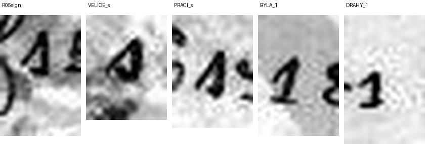

# HCP 1531 (pc_hcp_212): a Czech letter card from Pepouš to Anna Tichá, 11 November 1903

Human solver: Tomáš Pavuk

**Status: deciphered (383 of 383 cipher signs assigned; one shadowed sign restored from context). Independent review 1 gave the verdict REVISE. Its findings are addressed, and the meaning of the letter did not change.** Report dated 2026-10-29.

## Origin and context

The cryptogram is record 1531 of the HC Portal (https://crypto.hcportal.eu/dashboard/cryptograms/1531), portal name pc_hcp_212. It belongs to the HCPortal collection of cryptographic postcards (private collection). When it was captured on 2026-10-28, the portal showed:

- status **Not solved**
- tags Postcard, HCPortal collection; category Substitution
- date 1903-11-11, language Czech, location Europe
- sender Unknown, recipient Anna Tichá
- no transcription or solution attached

The picture side carries the cipher text in two blocks:

- nine rows at the upper right
- eight rows at the lower right, the last ones reaching leftward

The ordinary handwritten date **11./XI.1903** is on the picture side. The address side is in plain writing: *Velectěná Slečna / slečna Anna Tichá / učitelka v / Žirovnici / u Počátek* ("Honoured Miss Anna Tichá, teacher in Žirovnice near Počátky", South Bohemia).

The card is one of a family of cipher postcards to Anna Tichá. They are in the same hand and the same cipher, and signed by "Pepouš", a pet form of Josef. Many of them are deciphered in this repository (for example HCP 1520–1527, 1532, 1545 and 1556). The key used here is the family key, unchanged (ciphers/hcp-1545/work/key.json). A partial key for the family was published earlier by Maxim Egorov (https://maxim-egorov.dev/research/anna-ticha-postcards/). This card was therefore read with a **known key**; it is not a new key recovery. No published reading of this particular card was found or used.


## Method

The transcription is **manual**; no OCR was used. The solver made enlarged crops of each of the 17 cipher rows (work/R01.png to work/R17.png; row locations in work/indexed.png) and read them sign by sign. Each row is recorded with its box in the original image in work/transcription.json, and each of the 383 signs with its row and position in work/positions.csv. Doubtful signs were compared with other examples of the same shapes on the card (work/side-by-side-controls.png).


The signs are a mixture of digit-like shapes and Latin-like cursive letters. Each sign stands for one plaintext letter, and one special sign stands for the digraph CH. The family key decodes every sign of this card into connected Czech.

The reviewer took the opposite approach and tried to refute the reading:

- made its own 3× row crops and 6–10× zooms of every disputed word (review/work/);
- decoded the transcription with its own copy of the key (review/work/indep_decode.py);
- read 12 of the 17 rows sign by sign and the other five at row level.

## Key

Monoalphabetic substitution. The labels are conventional names for the handwritten shapes. Note these pairs:

- `m` stands for N and `n` for M
- `t` for D and `d` for T
- `c` (round, open) for S and `s` (peaked) for C
- `b` for P and `p` for B
- `ř` is a neutral label for the special CH sign

| Shape | Plain | Shape | Plain | Shape | Plain | Shape | Plain |
|---|---|---|---|---|---|---|---|
| 1 | Y | 2 | U | 3 | O | 4 | I |
| 5 | E | 6 | A | 7 | J | 8 | L |
| b | P | c | S | d | T | f | V |
| g | K | h | R | m | N | n | M |
| p | B | q | Z | r | H | s | C |
| t | D | ř | CH | | | | |

Czech diacritics are not encoded; the cipher writes base letters only.

Frequency of each sign on the card (383 in all): 1:5, 2:19, 3:32, 4:25, 5:49, 6:30, 7:10, 8:23, b:15, c:22, d:13, f:18, g:12, h:22, m:21, n:13, p:4, q:10, r:7, s:8, t:22, ř:3.

## Plaintext

Ciphertext as transcribed, row by row. `[4]` marks the one sign restored from context:

```text
R01 fh5832 b2c2 q6 th6r1 84cd5g. bh3-
R02 n4m, q5 m53tb3f5t58 7c5n cf5n2
R03 cht5sg2 t3c2t. f c3p3d2 h3qp38586
R04 c5 n4 r86f6 6 dh6b486 nm5 6q t3
R05 fs5h57cg6. p186 d3 n686 řh4bg6,
R06 m6c85tg5n gd5h5 7c5n f m5t584
R07 6 f b3mt584 n2c48 285rm32d4.
R08 bh4c83 n4 d3 f584s5 m5fr3t,
R09 b3m5f6tq bh6f5 m1m4 7c5n
R10 q6rhm4d bh6s4, gd5h32
R11 m4gt3 q6 nm5 m52t586.
R12 bc6m[4] 75 74q h3q5bc6m3,
R13 3t5c82 75 s3 m57th4f5.
R14 s3 t586 n375 cht5sg3? d4c4s
R15 fh581ř b3qth6f2 3t b5b32c5, gd5h1
R16 f t2ř2 m53c4c8m5 gh6d5 th6r32 df374
R17 r86f4mg2 84p6.
```

Literal Czech as decoded, line for line (base letters only; `[I]` is the restoration):

```text
VRELOU PUSU ZA DRAHY LISTEK. PRO-
MIN, ZE NEODPOVEDEL JSEM SVEMU
SRDECKU DOSUD. V SOBOTU ROZBOLELA
SE MI HLAVA A TRAPILA MNE AZ DO
VCEREJSKA. BYLA TO MALA CHRIPKA,
NASLEDKEM KTERE JSEM V NEDELI
A V PONDELI MUSIL ULEHNOUTI.
PRISLO MI TO VELICE NEVHOD,
PONEVADZ PRAVE NYNI JSEM
ZAHRNIT PRACI, KTEROU
NIKDO ZA MNE NEUDELA.
PSAN[I] JE JIZ ROZEPSANO,
ODESLU JE CO NEJDRIVE.
CO DELA MOJE SRDECKO? TISIC
VRELYCH POZDRAVU OD PEPOUSE, KTERY
V DUCHU NEOSISLNE KRATE DRAHOU TVOJI
HLAVINKU LIBA.
```

Normalised Czech. Accents, capitals and the PRO-/MIN join are editorial. The literal ZAHRNIT is normalised to *zahrnut*, and NEOSISLNE KRATE to *nesčíslněkráte*:

**Vřelou pusu za drahý lístek. Promiň, že neodpověděl jsem svému srdéčku dosud. V sobotu rozbolela se mi hlava a trápila mne až do včerejška. Byla to malá chřipka, následkem které jsem v neděli a v pondělí musil ulehnouti. Přišlo mi to velice nevhod, poněvadž právě nyní jsem zahrnut prací, kterou nikdo za mne neudělá. Psaní je již rozepsáno, odešlu je co nejdříve. Co dělá moje srdéčko? Tisíc vřelých pozdravů od Pepouše, který v duchu nesčíslněkráte drahou tvoji hlavinku líbá.**

English translation: **A warm kiss for your dear card. Forgive me that I have not yet answered my sweetheart. On Saturday I got a headache, and it tormented me until yesterday. It was a mild flu, because of which I had to lie down on Sunday and Monday. It came at a very bad time, since just now I am swamped with work that nobody will do for me. The letter is already begun; I will send it as soon as possible. How is my sweetheart? A thousand warm greetings from Pepouš, who in spirit kisses your dear little head countless times.**

Slovak translation: **Vrúcny bozk za drahý lístok. Prepáč, že som svojmu srdiečku doteraz neodpovedal. V sobotu ma rozbolela hlava a trápila ma až do včera. Bola to malá chrípka, kvôli ktorej som musel v nedeľu a v pondelok ležať. Prišlo mi to veľmi nevhod, pretože práve teraz som zavalený prácou, ktorú za mňa nikto neurobí. List je už rozpísaný, odošlem ho čo najskôr. Čo robí moje srdiečko? Tisíc vrúcnych pozdravov od Pepouša, ktorý v duchu nespočetnekrát bozkáva tvoju drahú hlávku.**

Notes on the reading:

- The date fits the story. 11 November 1903 was a Wednesday. The headache began on Saturday (7 Nov), the writer lay ill on Sunday and Monday, and the pain lasted "until yesterday", Tuesday.
- *Psaní* ("letter") is a neuter noun, as the following *je již rozepsáno … odešlu je* requires. The writer presumably means a longer letter to follow this card.
- *Srdéčko* ("little heart", "sweetheart"), *musil* and *ulehnouti* are ordinary forms of Czech of the period.

## Reproduction

From the repository root:

```sh
python3 -I ciphers/hcp-1531/work/decode.py
```

The script uses only the Python standard library and writes no files. It:

- checks the SHA-256 hashes of both scans, the metadata and the record files;
- decodes the manual transcription in work/transcription.json with the key in work/key.json;
- checks a sign-by-sign inverse-key round trip and the 383-position inventory in work/positions.csv;
- prints the seventeen literal rows above.

It does not read the image. The transcription step is manual and was checked in review.

## Uncertainties

- **PSAN[I] (row 12).** The last sign of the first word lies under a dark shadow in the printed photograph. What can be seen is a closed bowl with a long descender reaching into the next line, and a further faint oval. This looks more like the writer's `q`/`g` than `4`, and two signs may stand there. The I is **restored from context**, not read: PSANÍ is the only sensible noun before *je již rozepsáno*.
- **NEOSISLNE (row 16).** The 4th sign is the open `c` (S) also seen in TISIC. The 3rd looks like `3` (O) but may be the writer's hooked `s` (C). The intended word is clearly *nesčíslněkráte* ("countless times"). The sister card HCP 1532, by the same writer, has the same phrase as NESCISLNEKRATE.
- **ZAHRNIT (row 10).** The second-to-last sign is the writer's `4` (I), clearly different from the `2` (U) of KTEROU on the same row. The card therefore literally reads ZAHRNIT for *zahrnut* ("swamped"). This is a small writer's slip, confirmed by the reviewer.
- **Shadowed signs.** The photograph also darkens the 3rd sign of ODESLU (row 13), which looks 6-like and is read as E from context, and parts of ULEHNOUTI (row 7).
- Word boundaries, punctuation and accents are editorial.
- The sender is known only as Pepouš. His civil identity is not established.
- The key was transferred from the earlier family cards and the published partial key. It was not recovered blind from this card, but it decodes every sign here without change.
- The search for prior publication was limited to three sources: the portal status (Not solved), the AI Decipherment Register (checked 2026-10-29, no entry for this card) and the Cipher-Atelier Anna Tichá readings (no card 212).

## Review summary

Reviewer: Claude Opus 5.5 (Anthropic), a separate agent, round 1, verdict **REVISE**. The reviewer:

- ran the reproduction command;
- decoded the transcription with its own script and key (identical to the family key, all 383 signs agreeing);
- made its own crops and comparison panels from the original pixels;
- judged the text natural Czech of the period, consistent with the date and the recipient.

It raised five findings, all accepted:

1. **Row 5, VCEREJSKA (major).** At handover the second sign had been read as `1` (Y), giving VYEREJSKA, which was explained as a writer's slip. The reviewer's panel shows the sign is the peaked `s` (C) of VELICE and PRACI, not the footed `1` of BYLA and DRAHY. The card reads *do včerejška* directly; the "slip" claim was withdrawn.

   

2. **Inconsistent deliverables (major).** The header still said "partial", and the command still printed two unknown signs. The record was regenerated, and the command now prints the final text, with the restoration marked [I].
3. **PSAN[I] (minor).** This is now labelled a restoration from context, not a visual reading, and the possible second sign is noted.
4. **NEOSISLNE (minor).** The sign labels were corrected (4th sign `c`), the sister card HCP 1532 is cited, and an invented editorial form was replaced by *nesčíslněkráte*.
5. **ODESLU (minor).** Its shadowed 3rd sign is now listed as read from context.

The translation and the meaning of the letter did not change. One literal sign changed (row 5, Y to C), one sign label changed (row 16), and one sign was relabelled from "read" to "restored".

Credit:

- The initial transcription, controls and partial decipherment (two signs left open) were made by an OpenAI GPT solver (GPT-6 Astra) on 2026-10-28.
- Claude Opus 5.5 completed the reading, handed it to review, made the corrections after review and wrote this report on 2026-10-29.

## Sources

- HC Portal record 1531, General, Description and Attachments tabs, captured 2026-10-28: https://crypto.hcportal.eu/dashboard/cryptograms/1531 (source/metadata.md).
- Picture side: https://api.hcportal.eu/media/4653/conversions/pc_hcp_212_pic-large.jpg (source/picture.jpg).
- Address side: https://api.hcportal.eu/media/4654/conversions/pc_hcp_212_adr-large.jpg (source/address.jpg).
- Family key: earlier Anna Tichá family cards in this repository, ciphers/hcp-1545/work/key.json.
- Maxim Egorov, Anna Tichá postcards, published partial family key: https://maxim-egorov.dev/research/anna-ticha-postcards/
- AI Decipherment Register (https://ai.hcportal.eu/register/), checked 2026-10-29.
