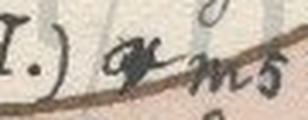
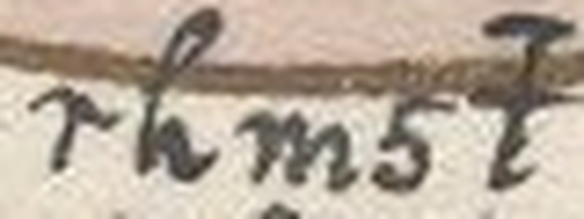
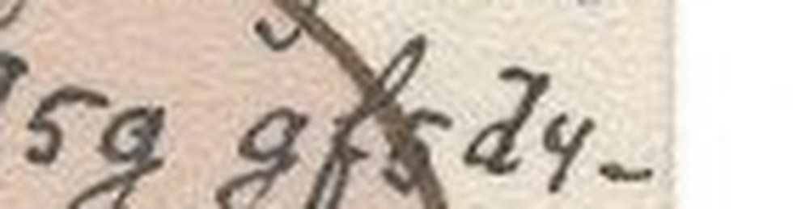

# HCP 1540 (pc_hcp_221): a Czech postcard from Pepouš to Anna Tichá, 9 September 1903

Human solver: Tomáš Pavuk

**Status: deciphered; 392 cipher signs read, plus one struck-over blot of about 1.5 signs (B03) that is restored from the sense only. Independent review 1 verdict REVISE; all findings addressed, and the reading is unchanged in substance.** Report dated 2026-10-29.

## Origin and context

The cryptogram is record 1540 of the HC Portal (https://crypto.hcportal.eu/dashboard/cryptograms/1540). Its portal name is pc_hcp_221, and it belongs to the HCPortal collection of cryptographic postcards (private collection). When the record was captured on 2026-10-28, the portal listed it as **Not solved**. It was tagged Postcard and HCPortal collection, with category Substitution, date 1903-09-09, language Czech, location Europe, sender Unknown and recipient Anna Tichá. No transcription or solution was attached.

The picture side shows an Art Nouveau portrait of a young woman with pink flowers in her hair, inside a gold-rimmed circle. The scan is sideways. Turned upright (90° counter-clockwise), the card has ten cipher rows below the picture (B01–B10). An arrow at the end of B10 leads to two further rows written upside down along the top edge (M01–M02), which end with the plain date **9./IX.1903.** A large wavy oval, filled with pale pink, is drawn over rows B03–B10. It is not cipher text, and the script stays readable through it.

The address side is in plain writing: **Velectěná Slečna / slečna Anna Tichá / učitelka t. č. / v Pelhřimově. / Vlastnoručně dodati.** ("Honoured Miss Anna Tichá, at present a teacher in Pelhřimov. To be delivered into her own hands.")

The card belongs to the family of cipher postcards to Anna Tichá in the same hand and the same cipher, signed "Pepouš" (a pet form of Josef). Many of them are deciphered in this repository (for example HCP 1520–1527, 1537, 1545 and 1556). The family key was transferred unchanged from those cards. A partial key for the family was published earlier by Maxim Egorov (https://maxim-egorov.dev/research/anna-ticha-postcards/). This card was therefore read with a **known key**; the key was not recovered from this card. No reading of this particular card was found or used.


## Method

The transcription is **manual**, with no OCR. The scan was turned upright and each row was cropped and enlarged (work/row-01.png … row-10.png, work/margin.png). Every sign was then classified by shape and recorded with a row-and-position ID in work/record.json. The earlier OpenAI GPT solver (GPT-6 Astra) made this first record. It left three spans under the dark ink marked as "unknown length". Claude Opus 5.5, acting as solver, then read those spans. After review, five documented corrections were applied on top of the unchanged first record (work/corrections.json). The family key decodes every sign of the card into connected Czech.

## Key

The cipher is a monoalphabetic substitution with one digraph sign. The labels below are conventional names for the handwritten shapes. Note the swapped pairs: `m` stands for N and `n` for M, `t` for D and `d` for T, `c` for S and `s` for C, `b` for P and `p` for B, and `r` for H and `h` for R. `H` is a marked r-shape that stands for CH. J has two signs, `y` and `7`.

| Shape | Plain | Shape | Plain | Shape | Plain | Shape | Plain |
|---|---|---|---|---|---|---|---|
| 1 | Y | 2 | U | 3 | O | 4 | I |
| 5 | E | 6 | A | 8 | L | y, 7 | J |
| b | P | c | S | d | T | f | V |
| g | K | h | R | m | N | n | M |
| p | B | q | Z | r | H | s | C |
| t | D | H | CH | | | | |

Czech diacritics are not enciphered: the cipher writes base letters only.

## Plaintext

Ciphertext as transcribed (⟦blot⟧ marks the illegible struck-over group):

```text
B01 cht5sm1 t4g q6 fqb3n4mg2 q s4qg3f6. bh6f4c q5
B02 s581 d4t5m n6hm5 s5g6c m6 n27 84cd5g. 3t5c868
B03 7c5n f 2d5h1 (I.) ⟦blot⟧m5t b3 m6fh6d2 cf3n q 2cd4
B04 84cd5g 2cd5sg1 6 f5 cdh5t2 (II.) 84cd5g gf5d4-
B05 m3f1. cb4c5 c5 n4 qt6, q5 6m2mg2 f bh6qtm4-
B06 m6H m6 nm5 q6b3n4m6. d5c48 7c5n c5, q5 t3-
B07 cd6m2 f bh6qtm4m6r 6cb3m y5tm3 bc6m4s3.
B08 gt1 m6cd32b4n t3f385m32, t3c2t m5n3r2 h4s4,
B09 m5ycb4c5 rhm5t b3 m6fh6d2 fhHm4r3 cbh6fs5.
B10 cht5sm1 b3qth6f 6 2bh4nm32 b2c2 q6c486 b5b32c.
M01 y6g cd3y4 df3y5 q685q4d3cd 3r85tm5 n4cd6
M02 b3 bh6qtm4m6H? 9./IX.1903.
```

Literal Czech, as decoded (base letters; the marks (I.), (II.) and the date are written in plain):

```text
B01 srdecny dik za vzpominku z cizkova. pravis ze
B02 cely tiden marne cekas na muj listek. odeslal
B03 jsem v utery (I.) ⟦blot⟧ned po navratu svom z usti
B04 listek ustecky a ve stredu (II.) listek kveti-
B05 novy. spise se mi zda, ze anunku v prazdni-
B06 nach na mne zapomina. tesil jsem se, ze do-
B07 stanu v prazdninah aspon jedno psanico.
B08 kdy nastoupim dovolenou, dosud nemohu rici,
B09 nejspise hrned po navratu vrchniho spravce.
B10 srdecny pozdrav a uprimnou pusu zasila pepous.
M01 jak stoji tvoje zalezitost ohledne mista
M02 po prazdninach? 9./IX.1903.
```

Normalized Czech. The accents are editorial. Where the writer's spelling differs from the standard form, the literal form is kept and the standard form follows in brackets. ⟦(i)h⟧ is the restored blot.

**Srdečný dík za vzpomínku z Čížkova. Pravíš, že celý tíden [týden] marně čekáš na můj lístek. Odeslal jsem v úterý (I.) ⟦(i)h⟧ned po návratu svom [svém] z Ústí lístek ústecký a ve středu (II.) lístek květinový. Spíše se mi zdá, že Anunku [Anunka] v prázdninách na mne zapomíná. Těšil jsem se, že dostanu v prázdnináh [prázdninách] aspoň jedno psaníco [psaníčko]. Kdy nastoupím dovolenou, dosud nemohu říci, nejspíše hrned [hned] po návratu vrchního správce. Srdečný pozdrav a upřímnou pusu zasílá Pepouš.**

**Jak stojí tvoje záležitost ohledně místa po prázdninách? 9./IX.1903.**

English translation: **Heartfelt thanks for the souvenir from Čížkov. You say you have been waiting in vain all week for a card from me. On Tuesday (I.), (immediately) after my return from Ústí, I sent a card from Ústí, and on Wednesday (II.) a flower card. It rather seems to me that Anunka forgets about me over the holidays. I was looking forward to getting at least one little letter during the holidays. When I will start my leave I cannot yet say; most likely right after the head steward returns. Heartfelt greetings and a sincere kiss from Pepouš.**

**How does your matter of a post after the holidays stand? 9 September 1903.**

Slovak translation: **Srdečná vďaka za spomienku z Čížkova. Píšeš, že celý týždeň márne čakáš na môj lístok. V utorok (I.) som (hneď) po návrate z Ústí odoslal ústecký lístok a v stredu (II.) kvetinový lístok. Skôr sa mi zdá, že Anunka cez prázdniny na mňa zabúda. Tešil som sa, že cez prázdniny dostanem aspoň jeden listík. Kedy nastúpim na dovolenku, ešte nemôžem povedať, najskôr hneď po návrate hlavného správcu. Srdečný pozdrav a úprimný bozk posiela Pepouš.**

**Ako stojí tvoja záležitosť ohľadom miesta po prázdninách? 9. IX. 1903.**

Notes on the reading:

- **Čížkov** is a village in the Pelhřimov district, where the recipient was teaching. The cipher gives only CIZKOVA; the first sign is the s-shape (C), not the Z-sign. **Ústí** is the town of that name on the sister cards; which Ústí is meant is not stated.
- **lístek květinový**, "a flower card": he means a picture postcard with flowers, like this one.
- **(I.) / (II.)** number the two cards he says he sent, on Tuesday and on Wednesday.
- **vrchní správce** ("head steward") is the manager of an estate, which suggests that Pepouš worked in estate administration. **místo po prázdninách** refers to Anna's teaching post for the new school year.
- The writer's own spellings are kept: *tíden*, *svom*, *Anunku* (for the nominative), *prázdnináh* (unmarked H for CH; the marked CH appears in B06 and M02), and *psaníco* (no K).

## Reproduction

From the repository root:

```sh
/Users/tomaspavuk/.cache/codex-runtimes/codex-primary-runtime/dependencies/python/bin/python3 -I ciphers/hcp-1540/work/decode2.py --indexed
```

Plain `python3 -I` gives the same result, because the script uses only the standard library. The script checks the SHA-256 of the frozen manual record and applies the five documented corrections in work/corrections.json. It then decodes every token with work/key.json, which is the family key. It prints a summary line (`5 documented corrections applied; 392 glyph units; 1 editorial restoration(s); 0 unknown-length spans`), the literal text, the text with the restoration, and an indexed table of every position. It does not read the image: the transcription is manual. The reviewer decoded the same tokens independently with the family key from ciphers/hcp-1545 and got the same text.

## Uncertainties

- **B03, the blot.** After "(I.)" there is a struck-over group about 1.5 signs wide, followed by a clear NED. Its signs cannot be read on the 1024-pixel scan. *hned* or *ihned* ("immediately") fits the sense, and either reading is editorial.

  

- **B09, HRNED.** The scan clearly shows five signs `r h m 5 t`, so the literal reading is HRNED. This is almost certainly a slip for *hned*. It was missed in the first transcription and found in review.

  

- **B04, KVĚTI-NOVÝ.** In this hand both the first sign K (`g`) and Z (`q`) are looped, so the shape alone does not decide between them. The reading K rests on the language (*zvětinový* is not a word) and on the context, since this is itself a flower card. The rest of the word, `f 5 d 4 -` and `m 3 f 1`, is clear.

  

- **B10, SRDEČNÝ.** The opening is overinked, but `c h t 5 s m 1` can be read, in the same form as the opening of B01.
- The pink oval's purpose (decoration, emphasis or cancellation) is not known. The text under it is read as part of the letter.
- The accents and the bracketed normalizations are editorial. The identities of Pepouš and of the "vrchní správce" are not established. The postmarks were not used for dating; the date rests on the plain 9./IX.1903 on the card.
- The key was transferred from the family, not recovered blind from this card. It decodes every legible sign here without change.

## Review summary

Reviewer: Claude Opus 5.5 (Anthropic), a separate agent, round 1, verdict **REVISE**. The reviewer ran the original command and decoded the tokens independently with the family key, with identical results. It rotated and enlarged the scan itself and compared the signs row by row. It confirmed the reading in substance, together with the context (Čížkov near Pelhřimov, Ústí, the flower card). Its findings, and what changed:

1. *The completed reading was not reproducible* (major). The first command still printed three unknown spans. Fixed: work/corrections.json and work/decode2.py now produce the full text, and the status statements in SOLUTION.md are consistent.
2. *B09 had a missing sign* (major). Fixed: HNED became the literal **HRNED**, disclosed as a slip for *hned*.
3. *IHNED in B03 is a restoration, not a reading.* Fixed: the literal output shows ⟦blot⟧, and (i)h is marked as editorial.
4. *The g/q argument rested too much on shape.* Fixed: the K reading is now argued from language and context.
5. *Undisclosed normalizations in the editorial Czech.* Fixed: the literal forms are kept, and the normalizations are given in brackets.
6. *The "unknown-length" labels overstated the damage.* Fixed: B04 and B10 are read in full, and only the B03 blot remains.

No decoded word changed meaning. The literal text changed in one place (HNED → HRNED), and B03 is now marked as restored.

**Credits.** The first manual transcription, record and partial decoding are by OpenAI GPT (GPT-6 Astra). The reading of the three obscured places, the response to the review and this report are by Claude Opus 5.5. The review is by a separate Claude Opus 5.5 agent.

## Sources

- HC Portal record 1540: General, Description and Attachments tabs, captured 2026-10-28. https://crypto.hcportal.eu/dashboard/cryptograms/1540 (source/metadata.md).
- Picture side: https://api.hcportal.eu/media/4680/conversions/pc_hcp_221_pic-large.jpg (source/picture.jpg).
- Address side: https://api.hcportal.eu/media/4681/conversions/pc_hcp_221_adr-large.jpg (source/address.jpg).
- Family key: earlier Anna Tichá cards in this repository (ciphers/hcp-1520/work/key.json, ciphers/hcp-1545/work/key.json).
- Maxim Egorov, Anna Tichá postcards, a published partial family key: https://maxim-egorov.dev/research/anna-ticha-postcards/
- AI Decipherment Register (https://ai.hcportal.eu/register/), checked on 2026-10-29: no entry for this card.
