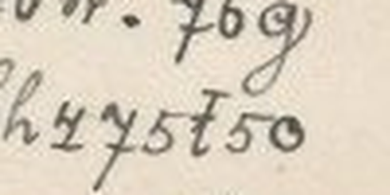

# HCP 1545 (pc_hcp_226): a Czech love letter from Pepouš to Anna Tichá, 8 August 1903

Human solver: Tomáš Pavuk

**Status: complete reading of all 362 key signs (7 of them the CH sign). One small dotted oval after PŘIJEDE is an unidentified mark, probably not a letter. Independent review 1 verdict ACCEPT; no decoded letter changed as a result of the review.** Report dated 2026-10-29.

## Origin and context

The cryptogram is record 1545 of the HC Portal (https://crypto.hcportal.eu/dashboard/cryptograms/1545), portal name pc_hcp_226, part of the HCPortal collection of cryptographic postcards (private collection). When it was captured on 2026-10-28 the portal listed it as **Not solved**, tagged Postcard, HCPortal collection, category Substitution, date 1903-08-08, language Czech, location Europe, sender Unknown, recipient Anna Tichá, with no transcription or solution attached.

It is a picture postcard showing a bunch of carnations (pink, dark red, yellow, white and red-and-yellow) with sprigs of green. The card is scanned sideways. Turned upright (90° clockwise), the main cipher text stands in twelve rows (R01–R12) at the lower right beside the stems, and the plain date **8./VIII. 1903.** is written at the lower left. A three-row continuation (M01–M03) runs upside down along the top right edge of the upright card and finishes the letter.

The address side is in plain writing: **Velectěná Slečna / slečna Anna Tichá / učitelka t. č. / v Pelhřimově.** ("Honoured Miss Anna Tichá, at present teacher in Pelhřimov"), with the note **Vlastnoručně dodati!** ("To be delivered into her own hands!"). It carries an Austrian 5-heller stamp cancelled PRAHA and an arrival postmark PILGRAM (the German name of Pelhřimov). The printer's line along the left edge reads "Farbenlichtdruck v. Martin Rommel & Co., Hofkunstanstalt, Stuttgart. 519."

The card belongs to a family of cipher postcards to Anna Tichá in the same hand and the same cipher, signed "Pepouš" (a pet form of Josef). Several of them are deciphered in this repository (for example HCP 1525, 1527, 1533, 1535, 1537 and 1556). The key was transferred unchanged from those cards (ciphers/hcp-1527/work/key.json); a partial key for the family had been published earlier by Maxim Egorov (https://maxim-egorov.dev/research/anna-ticha-postcards/). This card was therefore read with a **known, transferred key**; it is not a new key recovery. No reading of this particular card was supplied or consulted.


Other marks on the card, none of them cipher: the plain date, the address, the printed postcard headings in several languages, the printer's line, the stamp, the two postmarks, and the HCPortal watermark on both sides.

## Method

The transcription is **manual**. The picture side was turned upright for the twelve main rows and upside down for the three margin rows; each row was cut out as an enlarged crop (work/R01.png–R12.png, work/M01.png–M03.png) and read sign by sign. Each row, with its crop box and orientation, is recorded in work/transcription.json, and every sign with its row and index in work/positions.csv. No OCR was used and the portal supplied no transcription. Several first readings were corrected on the enlargements before handover, always by rereading the shapes and never by changing the key: KRIZOVAL (not ZRIKOVAL, R04), ANUNKO (not Aninko, R09) and PEPOUS (not Papous, M02). Difficult shapes were compared with other occurrences of the same sign on the same card (work/focused-controls.png).

The signs are a mixture of digit-like shapes and Latin-like cursive letters. Each stands for one plaintext letter, and one special sign stands for the digraph CH. The family key decodes every key sign on this card into connected Czech, with no unused or unknown key sign.

The transcription and the first, partial reading were made by an OpenAI GPT solver (GPT-6 Astra) on 2026-10-28; it left the mark at the end of R08 open. Claude Opus 5.5, as solver on 2026-10-29, examined that mark, completed the reading and handed it to review. In review, a separate Claude Opus 5.5 agent made its own rotations and 3–8× crops, read all fifteen rows itself, and decoded the transcription with its own script and its own statement of the key (review/work/indep_decode.py). All fifteen rows agreed with the solver's reading.

## Key

Monoalphabetic substitution. The labels are conventional names for the handwritten shapes, not exact reproductions. Note that the shape labelled `m` stands for N and `n` for M, `t` (crossed) for D and `d` (looped) for T, `c` (round) for S and `s` (angular) for C, and `b` for P and `p` for B. `7` labels the J-shaped sign, and `ř` the r-shape with a small cap, which stands for the digraph CH.

| Shape | Plain | Shape | Plain | Shape | Plain | Shape | Plain |
|---|---|---|---|---|---|---|---|
| 1 | Y | 2 | U | 3 | O | 4 | I |
| 5 | E | 6 | A | 7 | J | 8 | L |
| b | P | c | S | d | T | f | V |
| g | K | h | R | m | N | n | M |
| p | B | q | Z | r | H | s | C |
| t | D | ř | CH | | | | |

The family key also has a shallow v-shaped sign for F and a k-shaped sign for G; neither occurs on this card. Czech diacritics are not encoded: the cipher writes base letters only (Č as C, Ř as R, Í as I, and so on). The writer occasionally adds a háček by hand above a cipher sign (for example over the E of KOLUBENKU, see below); such marks are not part of the key.

Frequency of each sign on the card (362 in all): 1:10, 2:14, 3:20, 4:36, 5:35, 6:32, 7:14, 8:18, b:16, c:23, d:22, f:13, g:16, h:14, m:21, n:11, p:4, q:12, r:6, s:8, t:10, ř:7.

## Plaintext

Ciphertext as transcribed, row by row (punctuation and line-end hyphens as on the card; `{U01}` is the unidentified mark):

```text
R01 d4c4s5h1 t4g, q86d3
R02 n375, q6 th6r1 84cd5g.
R03 q674cd5 t3cd686 74q f b6d5g
R04 n27 84cd5g, 75mq c5 gh4q3f68
R05 c df1n "m5q6b3n4m6n, th6r32cg2,
R06 6m4 řf48g2, m1phq cd685 m6 cf374
R07 g382p5mg2 fh585 fqb3n4m6n. 76g
R08 cd374 f6c5 q685q4d3cd? bh475t5{U01}
R09 t3 bh6r1? nm5 d6g5, 6m2mg3, s6c
R10 85d5n 2p4r6. bh6s274 f5
R11 f38m1ř řf484ř b48m5 m6 t574m6ř
R12 s5s4845, 6p1ř 75 n3r8 75cd5 t3
M01 g3ms5 bh6qtm4m g d4cg2 bh4bh6f4d4. d4c4s 2bh4n-
M02 m1ř b2c b3c486 df27 b5b32c, d5c4s4 c5 m6 3b5dm1
M03 th6r1 84cd5g.
```

Literal Czech, as decoded, line for line (base letters only, no accents):

```text
R01 TISICERY DIK, ZLATO
R02 MOJE, ZA DRAHY LISTEK.
R03 ZAJISTE DOSTALA JIZ V PATEK
R04 MUJ LISTEK, JENZ SE KRIZOVAL
R05 S TVYM "NEZAPOMINAM, DRAHOUSKU,
R06 ANI CHVILKU, NYBRZ STALE NA SVOJI
R07 KOLUBENKU VRELE VZPOMINAM. JAK
R08 STOJI VASE ZALEZITOST? PRIJEDE[U01]
R09 DO PRAHY? MNE TAKE, ANUNKO, CAS
R10 LETEM UBIHA. PRACUJI VE
R11 VOLNYCH CHVILICH PILNE NA DEJINACH
R12 CECILIE, ABYCH JE MOHL JESTE DO
M01 KONCE PRAZDNIN K TISKU PRIPRAVITI. TISIC UPRIM-
M02 NYCH PUS POSILA TVUJ PEPOUS, TESICI SE NA OPETNY
M03 DRAHY LISTEK.
```

Normalized Czech (diacritics, capitals, punctuation and the joining of the split word upřím-ných are editorial; KOLUBENKU and ANUNKO are kept as written; the closing quotation mark is not placed, because the card does not show where the quotation ends):

**Tisícerý dík, zlato moje, za drahý lístek. Zajisté dostala již v pátek můj lístek, jenž se křižoval s tvým. „Nezapomínám, drahoušku, ani chvilku, nýbrž stále na svoji koluběnku [sic] vřele vzpomínám. Jak stojí vaše záležitost? Přijede do Prahy? Mně také, Anunko, čas letem ubíhá. Pracuji ve volných chvílích pilně na dějinách Cecilie, abych je mohl ještě do konce prázdnin k tisku připraviti. Tisíc upřímných pus posílá tvůj Pepouš, těšící se na opětný drahý lístek.**

English translation: **A thousand thanks, my treasure, for your dear card. Surely you got my card on Friday already; it crossed with yours. "I do not forget you, darling, even for a moment, but always think warmly of my little dove [the card has the odd form *koluběnku*]. How does your matter stand? Will [you / she] come to Prague? For me too, Anunka, time flies. In my free moments I am working hard on the history of Cecilie [Cecilia], so that I can still make it ready for printing before the end of the holidays. A thousand sincere kisses from your Pepouš, who looks forward to another dear card.**

Slovak translation: **Tisícoraká vďaka, zlato moje, za drahý lístok. Iste si už v piatok dostala môj lístok, ktorý sa skrížil s tvojím. „Nezabúdam, miláčik, ani na chvíľu, ale stále vrúcne spomínam na svoju holubičku [na karte zvláštny tvar *koluběnku*]. Ako stojí vaša záležitosť? Príde [si / ona] do Prahy? Aj mne, Anunka, čas letí. Vo voľných chvíľach usilovne pracujem na dejinách Cecílie, aby som ich ešte do konca prázdnin pripravil do tlače. Tisíc úprimných bozkov posiela tvoj Pepouš, ktorý sa teší na ďalší drahý lístok.**

Notes on the reading:

- **The opening quotation mark.** The card has an opening quotation mark before NEZAPOMINAM and no visible closing one. *svoji koluběnku* is feminine ("my little dove", of a woman), so the sentence is most naturally the writer speaking of Anna; it is punctuated here as the start of his own declaration. The punctuation, and whether the mark was meant to quote something, cannot be decided from the card.
- **KOLUBENKU / koluběnku.** The first sign of R07 has the long returning descender loop of the K sign (compare DIK in R01 and KRIZOVAL in R04), not the compact Z sign or the H sign, so the card literally reads KOLUBENKU; a háček is written by hand over the E. The intended word is almost certainly an endearment from *holoubek / holoubě* ("little dove"); the reading is kept as written and marked [sic].
- **Přijede do Prahy?** As written this is the 3rd person, "will [she] come to Prague?". The writer refers to Anna in the 3rd person on sister cards (HCP 1535: "Anunka mi určitě slíbila, že … přijede do Prahy"), but this card also uses the 2nd person ("s tvým"), so the question may concern Anna or another woman connected with "vaše záležitost" (your matter). See U01 below.
- **Zajisté dostala již v pátek** lacks the auxiliary *jsi*; it is a colloquial omission, "[you] surely got".
- **Anunko** is a pet form of Anna in the vocative, as on HCP 1533 and 1535 (ANUNKA). **pus** is the genitive plural of *pusa*, "kiss". **do konce prázdnin** ("before the end of the holidays") fits a card written in August.
- **dějiny Cecilie** ("the history of Cecilie") is not identified. One possibility, offered only as such, is a history of a St Cecilia society of the Cecilian church-music movement, which was active in Bohemia at the time; the card does not say.

## Reproduction

From the repository root:

```sh
/Users/tomaspavuk/.cache/codex-runtimes/codex-primary-runtime/dependencies/python/bin/python3 -I ciphers/hcp-1545/work/decode.py
```

The script needs Python with Pillow (the named interpreter has it) and writes no files. It checks the SHA-256 hashes of the scans and metadata, of the record files and of the credited reference files; checks that the key equals the family key of ciphers/hcp-1527; re-creates all fifteen row crops from source/picture.jpg in memory and compares them pixel for pixel with the saved crops; decodes the manual transcription in work/transcription.json with work/key.json; re-encodes the whole decoded text with the inverse key and checks it against the transcription; checks every indexed position in work/positions.csv and the saved work/plaintext.txt. It prints the fifteen literal rows and the line "Verified: … 362 mapped cipher units + 1 unidentified non-key mark … 7 CH units …". It does not read the handwriting itself; the transcription step is manual and was confirmed independently in review. Because it verifies files outside ciphers/hcp-1545 (ciphers/hcp-1527/work/ and batches/easy-2026-10-28/), it runs only in a checkout that contains those files.

## Uncertainties

- **U01, an unidentified mark.** At the end of R08, directly after `bh475t5` = PRIJEDE, there is one small closed oval with a dot inside. It matches none of the 22 key signs, and no family card gives it a letter. It is treated as **an unidentified mark, probably not a letter**, and kept visible as [U01] in the literal text. PŘIJEDE is complete and grammatical without it. A 2nd-person ending (PŘIJEDEŠ, "will you come?") cannot be fully excluded, but Š is written with the ordinary S sign on this card (PEPOUŠ = `b5b32c`), not with a special sign, and PŘIJEDETE would need the two signs `d5`, which are not there. The meaning of the question is much the same either way. The earlier solver had recorded the area as a region of one or two signs; the enlargement shows a single small oval. (A legacy status label in work/positions.csv still names it a "1-2 units" region; that file is hash-locked and was not changed.)



- **KOLUBENKU** is kept as written (see above). The K/Z distinction in this hand is weak (a 9-like Z against a g-like K with a long loop); every K/Z choice on the card was checked in context by both solver and reviewer, and none flips a word.
- **Close calls, all checked on the scan:** the D/T, S/C, B/P, M/N and I/Y pairs throughout; ANUNKO (third sign clearly U), PEPOUS (E, not A), KRIZOVAL; the seven CH signs in R06, R11, R12 and M02. Printed leaves of the bouquet overlap a few signs, but none is lost.
- The accents, punctuation and word joins of the normalized Czech are editorial. The cipher encodes base letters only.
- The sender is known only as Pepouš (Josef); his civil identity is not established. "Cecilie" and "vaše záležitost" are not explained by the card.
- The key was transferred from the earlier family cards and the published partial key, not recovered blind from this card; it decodes every key sign here without change.
- No search for a prior publication of this card was made beyond the portal status (Not solved) and the AI Decipherment Register (no record for cryptograms/1545, checked 2026-10-28 and 2026-10-29).

## Review summary

Reviewer: Claude Opus 5.5 (Anthropic), a separate agent, round 1, verdict **ACCEPT**. The reviewer ran the reproduction command (exit 0, output identical to the claimed plaintext), decoded the transcription with an independent script and its own statement of the key (all fifteen rows agree, 362 units, no unmapped sign), and read all fifteen rows on its own rotations and enlargements of the scan, checking in particular the first sign of KOLUBENKU, ANUNKO, PEPOUS, KRIZOVAL and the rows with CH. It confirmed the context (Prague sender, Pelhřimov recipient, an August date fitting "do konce prázdnin") and that the transferred key and the earlier partial study were openly credited. Its four findings were minor and are reflected here:

- **U01 is a non-letter by interpretation, not proof.** This report calls it an unidentified mark, probably not a letter, keeps it visible, and names PŘIJEDEŠ as an alternative that cannot be fully excluded.
- **Contradictory status in SOLUTION.md** (an older "partial" heading next to the later "complete reading"). SOLUTION.md now opens with one harmonized status, and the decoder's two summary lines say the same; no data file changed.
- **Háček over the E of KOLUBENKU.** Confirmed on the scan; the normalized Czech now reads *koluběnku* [sic].
- **"Cecilie".** The Cecilian-society possibility is mentioned above, as a possibility only.

No decoded letter changed as a result of the review. Credit: the transcription, the decoder and the first partial reading were made by OpenAI GPT (GPT-6 Astra) on 2026-10-28; the completion (U01), the response to review, this report and the register entry were prepared by Claude Opus 5.5 as solver on 2026-10-29.

## Sources

- HC Portal record 1545, General, Description and Attachments tabs, captured 2026-10-28: https://crypto.hcportal.eu/dashboard/cryptograms/1545 (source/metadata.md).
- Picture side: https://api.hcportal.eu/media/4695/conversions/pc_hcp_226_pic-large.jpg (source/picture.jpg).
- Address side: https://api.hcportal.eu/media/4696/conversions/pc_hcp_226_adr-large.jpg (source/address.jpg).
- Family key: earlier Anna Tichá family cards in this repository, ciphers/hcp-1527/work/key.json.
- Maxim Egorov, Anna Tichá postcards, published partial family key: https://maxim-egorov.dev/research/anna-ticha-postcards/
- AI Decipherment Register (https://ai.hcportal.eu/register/), checked 2026-10-28 and 2026-10-29.
