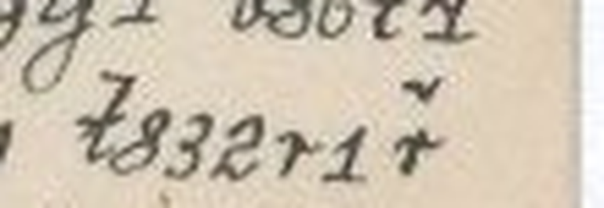
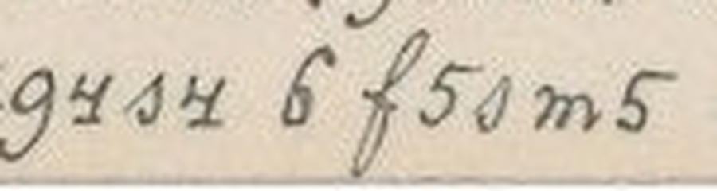

# HCP 1553 (pc_hcp_234): a Czech love letter from Pepouš to Anna Tichá

Human solver: Tomáš Pavuk

**Status: deciphered in full (326 cipher signs, 330 letters). One sign is restored from context, and one is visually anomalous. Independent review 1 gave the verdict REVISE; two misread words were corrected as a result.** Report dated 2026-10-29.

## Origin and context

The cryptogram is record 1553 of the HC Portal (https://crypto.hcportal.eu/dashboard/cryptograms/1553), portal name pc_hcp_234. It belongs to the HCPortal collection of cryptographic postcards, which is a private collection. When the record was captured on 2026-10-28, the portal listed it as **Not solved**, with these details:

- tags: Postcard, HCPortal collection
- category: Substitution
- date: 1903-05-25
- language: Czech
- location: Europe
- sender: Unknown
- recipient: Anna Tichá

No transcription or solution was attached.

The card is a picture postcard. It is scanned sideways; turned 90° clockwise, the cipher text fills eight rows at the bottom of the picture side. The plain date **25./V.1903.** stands with them. 25 May 1903 was a Monday.

The address side is in plain writing: **Velectěná Slečna / slečna Anna Tichá / učitelka v / Žirovnici / u Počátek.** ("Honoured Miss Anna Tichá, teacher in Žirovnice near Počátky", South Bohemia). It carries a green 5-heller stamp and two postal impressions. The left one shows Žirovnice / Seirovitz forms, V and 03; its day is not legible.

The card belongs to a family of cipher postcards to Anna Tichá written in the same hand and the same cipher. They are signed "Pepouš", a pet form of Josef, and several are deciphered in this repository (for example HCP 1520–1527 and 1537–1556). The key was transferred from those earlier cards (ciphers/hcp-1520/work/key.json). Maxim Egorov published a partial key for the family earlier (https://maxim-egorov.dev/research/anna-ticha-postcards/). This card was therefore read with a **known, transferred key**; it is not a new key recovery. No reading of this particular card was supplied or consulted.

Sister card HCP 1554, written three days earlier on 22 May 1903, plans the same meeting:

- a meeting on Wednesday;
- Pepouš arriving by the express (rychlík) at 9:40 in the morning;
- telegrams as a fallback if something goes wrong.

This card confirms the arrangement two days before the meeting, which falls on Wednesday 27 May.


None of the following marks are cipher:

- the plain date and the address;
- the printed postcard headings;
- the stamp and the postmarks;
- the HCPortal watermark.

No other cipher text was found on either side.

## Method

The transcription was made by hand. The scan was turned upright, and each of the eight rows was read sign by sign from enlarged row crops (work/row-01.png to row-08.png), with no OCR. The signs mix digit-like shapes and Latin-like cursive letters. Each sign stands for one plaintext letter, except one special sign that stands for the digraph CH.

The family key decodes the card into connected Czech. The work was done in three stages:

1. **Initial transcription (OpenAI GPT).** The first transcription and partial decoding were made by an OpenAI GPT solver (GPT-6 Astra / GPT-6.1 Sol). It left three places open:
   - a k-shaped sign not in the family key;
   - a short stroke in row 2;
   - a heavily overinked sign before ESET in row 2.
2. **Completion (Claude Opus 5.5).** Claude Opus 5.5, working as solver, settled the three places:
   - The k-shaped sign is the family's **G** (TELEGRAMY). The same sign stands in SVAGRA on HCP 1541 and twice on HCP 1570, both places where only G gives a Czech word.
   - The short stroke is a dash, not a letter.
   - The overinked sign is restored as D, giving DESET (o tři čtvrtě na deset, 9:45).
3. **Independent review (Claude Opus 5.5).** A separate Claude Opus 5.5 agent cut every row into 5× crops and made 7–12× enlargements of every disputed place. It decoded the transcription with its own script and its own statement of the key. It found two words in rows 7–8 that had been read from expectation rather than from the card. Both were corrected (see the review summary below).





## Key

The cipher is a monoalphabetic substitution. The labels are conventional names for the handwritten shapes. Several labels stand for a different letter than they look like:

- `m` stands for N, and `n` for M;
- `t` (crossed) stands for D, and `d` (looped) for T;
- `c` (round) stands for S, and `s` (backwards-6) for C;
- `b` stands for P, and `p` for B;
- `r` (short) stands for H, and `h` (tall) for R.

`y` labels the 7-shaped sign for J; the family key file labels the same sign `7`. `H` labels the r-shape with a caron, which stands for CH. `G` labels the k-shaped sign, which stands for G.

| Shape | Plain | Shape | Plain | Shape | Plain | Shape | Plain |
|---|---|---|---|---|---|---|---|
| 1 | Y | 2 | U | 3 | O | 4 | I |
| 5 | E | 6 | A | y | J | 8 | L |
| b | P | c | S | d | T | f | V |
| g | K | h | R | m | N | n | M |
| p | B | q | Z | r | H | s | C |
| t | D | H | CH | G | G | | |

The family also has a shallow v-shaped sign for F; it does not occur on this card. Czech diacritics are not encoded: the cipher writes base letters only, so Č is written as C, Ř as R, and so on.

The card has 326 signs in all. Their frequencies are: 1:6, 2:19, 3:22, 4:28, 5:39, 6:25, y:11, 8:8, b:16, c:17, d:19, f:7, g:11, h:19, m:24, n:11, p:4, q:11, r:2, s:7, t:15, H:4, G:1.

## Plaintext

The ciphertext as transcribed, row by row. `[t]` marks the overinked sign restored from context. `{5}` marks the anomalous sign in ANENKA. `~` marks the short dash stroke.

```text
R1 cht5sg3 n3y5 y5t4m5, d5c4n c5 m6 cdh5t2 m5cn4hm5.
R2 bh4y5t2, y6g ~ 2y5tm6m3, h1H84g5n 3 dh4 sdfhd5 m6 [t]5c5d
R3 h6m3. m5q6b3n5m5 6m{5}mg6 m6 b3t3p5mg1, 3 y4Hq 3g6-
R4 q6m4 yc5n bh3c48? d5c4n c5, 6m2mg3, y4q d32q5pm5, 6q
R5 p2t2 n3s4 bh4 bh4y5qt2 cf5n df32 th6r32 h2sg2 cd4cgm32-
R6 d4 6 q84p6d4. bh3 bh4b6t m5bh5tf4t6m5 bh5g6qg1 b86d4
R7 2y5tm6m5 d585Gh6n1. q6d4n b3c486 d4 d4c4s t832r1H
R8 fh581H b2c d32q4s4 6 f5sm5 df2y b5b32c.
```

The literal Czech, as decoded (base letters only, no accents):

```text
R1 srdecko moje jedine, tesim se na stredu nesmirne.
R2 prijedu, jak - ujednano, rychlikem o tri ctvrte na [d]eset
R3 rano. nezapomene an{e}nka na podobenky, o jichz oka-
R4 zani jsem prosil? tesim se, anunko, jiz touzebne, az
R5 budu moci pri prijezdu svem tvou drahou rucku stisknou-
R6 ti a zlibati. pro pripad nepredvidane prekazky plati
R7 ujednane telegramy. zatim posila ti tisic dlouhych
R8 vrelych pus touzici a vecne tvuj pepous.
```

The normalized Czech below is editorial in its diacritics, capitals, punctuation and joining of split words. ANENKA, ANUNKO and OKÁZÁNÍ are kept as written:

**Srdéčko moje jediné, těším se na středu nesmírně. Přijedu, jak ujednáno, rychlíkem o tři čtvrtě na deset ráno. Nezapomene Anenka na podobenky, o jichž okázání jsem prosil? Těším se, Anunko, již toužebně, až budu moci při příjezdu svém tvou drahou ručku stisknouti a zlíbati. Pro případ nepředvídané překážky platí ujednané telegramy. Zatím posílá ti tisíc dlouhých vřelých pus toužící a věčně tvůj Pepouš.**

English translation: **My one and only sweetheart, I am looking forward to Wednesday immensely. I shall come, as agreed, by the express at a quarter to ten in the morning. Will Anenka not forget the photographs she was to show me, as I asked? I am already longing, Anunka, for the moment when on my arrival I can press your dear little hand and kiss it. In case of an unforeseen obstacle, the telegrams we agreed on hold. Meanwhile, longing and eternally yours, Pepouš sends you a thousand long, warm kisses.**

Slovak translation: **Srdiečko moje jediné, nesmierne sa teším na stredu. Prídem, ako sme sa dohodli, rýchlikom o tri štvrte na desať ráno. Nezabudne Anenka na fotografie, ktoré som ju prosil ukázať? Už túžobne sa teším, Anunka, keď budem môcť pri svojom príchode stisnúť a pobozkať tvoju drahú rúčku. Pre prípad nepredvidanej prekážky platia dohodnuté telegramy. Zatiaľ ti posiela tisíc dlhých vrúcnych bozkov túžiaci a večne tvoj Pepouš.**

Notes on the reading:

- **Na středu, rychlíkem o tři čtvrtě na deset.** The letter looks ahead to Wednesday 27 May 1903. A quarter to ten is 9:45. Sister card HCP 1554 gives the express as 9:40, which is consistent with this time, though not identical.
- **Ujednané telegramy.** These are the telegrams agreed as a fallback. On HCP 1554 they are to be sent poste restante to Veselí.
- **Anenka, Anunko.** Both are pet forms of Anna; the writer uses the third person ("will Anenka not forget"), which is affectionate.
- **Podobenky** are photographs (portrait cards).
- **Okázání** is an old or variant form of *ukázání*, "showing". The words **oka-zání** and **stisknou-ti** are split across rows.
- **Pus** is the genitive plural of *pusa*, "kiss".

## Reproduction

From the repository root:

```sh
python3 -I ciphers/hcp-1553/work/decode2.py
```

The script uses only the Python standard library and writes no files. It does the following:

1. checks the SHA-256 hashes of the two scans and the metadata;
2. checks that the key work/key-v2.json is the family key (work/key.json) plus G;
3. decodes the manual transcription work/transcription-v2.tsv;
4. compares the result with the saved work/literal-v2.txt;
5. prints the eight literal rows shown above, followed by the line `Rows: 8; cipher units: 326 (1 anomalous {}, 1 restored []); plaintext letters: 330; CH units: 4; G units: 1`.

The script does not read the images. The transcription step was done by hand and was checked independently in review. The reviewer's independent decode (review/work/decode_reviewer.txt) agrees with the output letter for letter, once the restoration brackets and the dash are removed. The older work/decode.py audits the pre-review transcription and is superseded.

## Uncertainties

- **DESET.** The first sign of *deset* is heavily overinked; it may have been corrected by the writer. Its tall stem with a top flick and a crossbar fits the crossed t (= D), but the pixels alone do not settle it. Only *deset* fits "o tři čtvrtě na ?eset". The reading is therefore a restoration from context with visual support.
- **ANENKA.** The third sign of ANENKA is a looped, plaintext-style "e". It is not the card's regular 5 (= E) and not clearly its 2 (= U). It is most likely a slip into plain script. The reading ANUNKA, matching "Anunko" in row 4, cannot be excluded. Both forms refer to Anna.
- **G.** The k-shaped sign is not in the published family key. Its value G is a family assignment inferred from context. The same sign stands where only G gives a Czech word in TELEGRAMY here, in SVAGRA on HCP 1541, and twice on HCP 1570. The family key has no other sign for G.
- **First sign of SRDÉČKO.** This sign is a closed-loop variant of S with a long lead-in. The usual open c-form is not used here. The word is certain from context.
- **The dash in row 2.** The short stroke between JAK and UJEDNÁNO has no letter body. It is recorded as a dash, not a letter.
- **Editorial choices.** The accents, punctuation and word joins of the normalized Czech are editorial.
- **Identities.** The sender is known only as Pepouš (Josef); his civil identity is not established.
- **Postmark.** The postmark day is not legible. The date rests on the plain 25./V.1903 on the card and on the portal metadata.
- **Key.** The key was transferred from earlier family cards and from the published partial key. It was not recovered blind from this card.

## Review summary

Reviewer: Claude Opus 5.5 (Anthropic), a separate agent from the solver. Round 1, verdict **REVISE**.

The reviewer took these steps:

1. ran the reproduction command;
2. wrote an independent decoder from the family key;
3. rotated and cut the scan itself, then read all eight rows sign by sign at 5–12×;
4. checked the date, the address and the sister card HCP 1554.

It found the key and most of the reading correct, and agreed with the completions G, the dash and DESET. Its findings, and what changed:

1. **Row 7: DLOUHÝCH, not VROUCÍCH (major).** The last word of row 7 is `t 8 3 2 r 1 ř`, *dlouhých* ("long"). The earlier *vroucích* ("fervent") had been read from expectation. **Corrected.**
2. **Row 8: VĚČNĚ, not VĚRNĚ (major).** The fourth sign of the word is the backwards-6 C, not the tall R, so the sign-off is "a věčně tvůj Pepouš" ("and eternally yours"). It matches the sign-off on HCP 1554. **Corrected.**
3. **The command printed the old partial text (major).** A new key (with G), a new transcription and a new decoder (work/decode2.py) now print the completed reading. **Fixed.**
4. **Wording of the G evidence (minor).** The overstated "four cards" claim was replaced by the actual evidence: this card, HCP 1541 and HCP 1570.
5. **DESET (minor).** It is now marked as a restoration, and the comparison with 9:40 is stated as "consistent with", not "agrees with".
6. **The dash (minor).** It is kept in the records as a non-letter mark.
7. **ANENKA (minor).** The anomalous sign is now disclosed.
8. **First sign of SRDÉČKO (minor).** It is now noted as a variant of S.
9. **J label (minor).** The difference from the family file (`y` here, `7` there) is noted.

The two corrected words do not change the sense of the letter; they only change its wording. The response to the review, this report and the register entry were prepared by Claude Opus 5.5 as solver.

## Sources

- HC Portal record 1553 (General, Description and Attachments tabs), captured 2026-10-28: https://crypto.hcportal.eu/dashboard/cryptograms/1553 (source/metadata.md).
- Picture side: https://api.hcportal.eu/media/4719/conversions/pc_hcp_234_pic-large.jpg (source/picture.jpg).
- Address side: https://api.hcportal.eu/media/4720/conversions/pc_hcp_234_adr-large.jpg (source/address.jpg).
- Family key: earlier Anna Tichá family cards in this repository, ciphers/hcp-1520/work/key.json. The G sign is supported by ciphers/hcp-1541 and ciphers/hcp-1570.
- Maxim Egorov, Anna Tichá postcards, published partial family key: https://maxim-egorov.dev/research/anna-ticha-postcards/
- AI Decipherment Register (https://ai.hcportal.eu/register/): no record for this card, checked 2026-10-28 and again on 2026-10-29.
