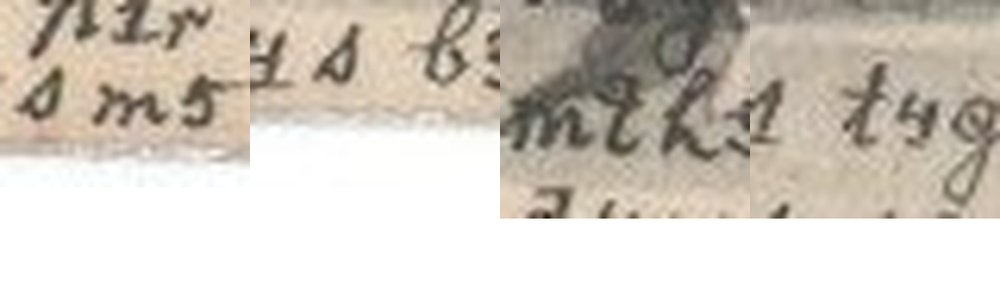

# HCP 1557 (pc_hcp_238): an Easter card from Pepouš to Anna Tichá

Human solver: Tomáš Pavuk

**Status: deciphered in full except one letter hidden under the printed picture, which is restored from the sentence ([N]a) and marked as such. 295 legible cipher signs (301 letters). Independent review 1 verdict REVISE; all findings addressed. The review changed the literal transcription in four places but not the reading.** Report dated 2026-10-29.

## Origin and context

The cryptogram is record 1557 of the HC Portal (https://crypto.hcportal.eu/dashboard/cryptograms/1557), portal name pc_hcp_238, part of the HCPortal collection of cryptographic postcards (private collection). When it was captured on 2026-10-28 the portal listed it as **Not solved**, tagged Postcard, HCPortal collection, category Substitution, date 1903-04-08, language Czech, location Europe, sender Unknown, recipient Anna Tichá. No transcription or solution was attached.

It is a printed Easter postcard. It shows a winged girl resting her head on a large egg among blossoming branches, with the printed greeting **Veselé velikonoce.** ("Happy Easter."). The writer added the plain date **8./IV. 1903.** (Wednesday, 8 April 1903, in Holy Week; Easter Sunday fell on 12 April 1903). The cipher text fills four rows along the bottom edge of the picture side. Parts of the first three rows run over the printed flowers and leaves, which lowers the contrast there.

The address side is in plain writing: **Velectěná Slečna / slečna Anna Tichá / učitelka t. č. / v Pelhřimově. Vlastnoručně dodati.** ("Honoured Miss Anna Tichá, at present a teacher, in Pelhřimov. To be delivered into her own hands."). It has an Austrian 5-heller stamp with a partly legible cancellation. It also has an arrival postmark reading "… PILGRAM" (Pelhřimov) with day 9 and a roman month, most likely IV. That would mean the card arrived on 9 April 1903, the day after it was written.


The card belongs to a family of cipher postcards to Anna Tichá that share one hand and one cipher. They are signed "Pepouš" (a pet form of Josef), and many of them are deciphered in this repository (for example HCP 1520–1527 and 1544–1556). The key was transferred unchanged from those cards (ciphers/hcp-1520/work/key.json). A partial key for the family was published earlier by Maxim Egorov (https://maxim-egorov.dev/research/anna-ticha-postcards/). This card was therefore read with a **known, transferred key**; it is not a new key recovery. No reading of this particular card was supplied or consulted.

Other marks on the card are not cipher: the printed greeting, the plain date, the address, the printed postcard headings, the stamp and postmarks, and the circular HCPortal watermark on both sides. No cipher text was found on the address side or in the margins.

## Method

The transcription is **manual**; no OCR was used and the portal supplied none. The four rows (R1–R4) were read sign by sign from enlarged crops of the scan. Each row is recorded with its box in work/rows.json, and each sign with its row, word and position in work/positions.json. Close calls were checked against other occurrences of the same shape on the same card. Examples are the D/T pair in ZTRAVILO and the two-hump N against the one-hump M in NASICH.

The cipher is a monoalphabetic substitution of mixed digit-like and Latin-cursive shapes, one shape per plaintext letter, plus one special shape for the digraph CH. Czech diacritics are not encoded. The family key decodes every legible sign of this card into connected Czech, and no sign is left over or unknown.

The work was done in stages. An OpenAI GPT solver (GPT-6 Astra / GPT-6.1 Sol) made the transcription, the decipherment with the family key and the visual controls; it left the reading as partial because of the hidden first letter of row 1. Claude Opus 5.5 then completed the solution. It judged that the hidden ink is one sign wide and restored that sign as N, and it handed the card to review. A separate Claude Opus 5.5 agent reviewed it.


## Key

The labels are conventional names for the handwritten shapes. Note the swapped pairs: the shape labelled `m` stands for N and `n` for M. Likewise crossed `t` is D and looped `d` is T, the open `c` is S and the small looped `s` is C, and `b` is P and `p` is B. `y` labels the J-sign, which looks like a 7. `H` is the r-shape with a small cap, which stands for CH.

| Shape | Plain | Shape | Plain | Shape | Plain | Shape | Plain |
|---|---|---|---|---|---|---|---|
| 1 | Y | 2 | U | 3 | O | 4 | I |
| 5 | E | 6 | A | y | J | 8 | L |
| b | P | c | S | d | T | f | V |
| g | K | h | R | m | N | n | M |
| p | B | q | Z | r | H | s | C |
| t | D | H | CH | | | | |

The family key also has a shallow v-shaped sign for F, which does not occur on this card.

Frequency of each sign on the card (295 legible signs): 1:10, 2:16, 3:22, 4:23, 5:34, 6:17, y:9, 8:15, b:13, c:18, d:15, f:13, g:8, h:13, m:17, n:9, p:5, q:8, r:2, s:6, t:16, H:6; plus one unreadable sign (U1).

## Plaintext

Ciphertext as transcribed, row by row (`{U1}` = the sign under the printed leaf):

```text
R1 fh581 t4g q6 th6r1 84cd5g. {U1}6 bc6mg3 c5 m5cn4hm5 d5c4n. bh5y4 cf5n2 cht5sg2, 6p1 qdh6f483
R2 cf6dg1 s3 m3ybh4y5nm5y4! b3g2t nm5 c5 d1s5 m5f4n, m5p2t2-84 n2c5d4 3t83q4d4 cf3y4 s5cd2, b3m5-
R3 f6tq 3b5d y5t5m q m6c4H g3mth383h2 3H2h6f58. gt1p1H n3h8 3ty5d4, y58 p1H m6 m5t584 6 b3mt584,
R4 fqb3n4m6d4 p2t2 d5q cd685. d4c4s b3qth6f2 6 t832r1H fh581H b2c b3c486 f5 sm5 df2y b5b32c.
```

Literal Czech, as decoded (base letters only):

```text
R1 vrely dik za drahy listek. {U1}a psanko se nesmirne tesim. preji svemu srdecku, aby ztravilo
R2 svatky co nojprijemneji! pokud mne se tyce nevim, nebudu-li museti odloziti svoji cestu, pone-
R3 vadz opet jeden z nasich kondroloru ochuravel. kdybych morl odjeti, jel bych na nedeli a pondeli,
R4 vzpominati budu tez stale. tisic pozdravu a dlouhych vrelych pus posila ve cne tvuj pepous.
```

Normalized Czech. The diacritics, capitals, punctuation and the joining of pone-/vadz are editorial. The restored letter is in square brackets, and the writer's slips are corrected (see Uncertainties):

**Vřelý dík za drahý lístek. [N]a psánko se nesmírně těším. Přeji svému srdéčku, aby strávilo svátky co nejpříjemněji! Pokud mne se týče, nevím, nebudu-li museti odložiti svoji cestu, poněvadž opět jeden z našich kontrolorů ochuravěl. Kdybych mohl odjeti, jel bych na neděli a pondělí. Vzpomínati budu též stále. Tisíc pozdravů a dlouhých vřelých pus posílá ve sně tvůj Pepouš.**

English translation: **Warm thanks for your dear card. I am looking forward immensely to your little letter. I wish my little heart to spend the holidays as pleasantly as possible! As for me, I do not know whether I shall have to put off my journey, because once again one of our inspectors has fallen ill. If I could get away, I would come for Sunday and Monday. I shall be thinking of you all the time anyway. A thousand greetings and long warm kisses, in a dream, from your Pepouš.**

Slovak translation: **Vrúcna vďaka za drahý lístok. [N]a list sa nesmierne teším. Želám svojmu srdiečku, aby strávilo sviatky čo najpríjemnejšie! Pokiaľ ide o mňa, neviem, či nebudem musieť odložiť svoju cestu, pretože opäť jeden z našich kontrolórov ochorel. Keby som mohol odísť, išiel by som na nedeľu a pondelok. Spomínať budem tiež stále. Tisíc pozdravov a dlhých vrúcnych bozkov posiela vo sne tvoj Pepouš.**

Notes on the reading:

- **svátky … neděli a pondělí.** The card was written on Wednesday of Holy Week. "The holidays" are Easter, and "Sunday and Monday" are Easter Sunday and Easter Monday (12–13 April 1903). The writer hoped to visit for them.
- **psánko** is a diminutive of psaní ("letter"); **srdéčko** ("little heart") is a term of endearment for Anna; **pus** is the genitive plural of pusa, "kiss".
- **kontrolor** ("inspector, controller") is probably a colleague in the writer's office or service. The card does not say which.
- **ochuravěl** ("has fallen ill") is from the verb ochuravět, "to fall ill".

## Reproduction

From the repository root:

```sh
/Users/tomaspavuk/.cache/codex-runtimes/codex-primary-runtime/dependencies/python/bin/python3 ciphers/hcp-1557/work/decode.py
```

Plain `python3 -I` gives the same result. The script uses only the standard library and writes no files. It does the following:

- checks the SHA-256 hashes of the scans, the metadata, the credited reference files and the 25 local record files;
- checks that the key equals the family key;
- decodes work/manual-transcript.txt with work/key.json, cross-checks every indexed position, and compares the result with work/literal-cz.txt;
- re-encodes the whole literal text with the inverse key and compares it with the transcription.

It prints the four literal rows and a summary: 295 known units, 301 base letters, 6 CH, 1 unknown run. It does not read the image, because the transcription step is manual. Because it verifies files in ciphers/hcp-1520/work/ and batches/easy-2026-10-28/, it runs only in a checkout that contains them.

## Uncertainties

- **One restored letter.** At the start of the second sentence (R1), the sign before A is covered by a dark printed leaf. Its width is that of one cipher sign, but no stroke can be read. "[?]a psánko se nesmírně těším" admits only **Na** ("I look forward to the little letter"). The letter is a **restoration, not a reading**. The literal output keeps `{U1}`.
- **Writer's slips, kept in the literal text.** In four places the writer wrote a near-miss sign or the ordinary plaintext letter instead of the cipher sign:
  - **MORL** for *mohl*: he wrote the letter h, which in the cipher means R.
  - **VE CNE** for *ve sně*: he wrote the letter s, which means C.
  - **KONDROLORU** for *kontrolorů*: he wrote the letter t, which means D.
  - **NOJPRIJEMNEJI** for *nejpříjemněji*: an O-sign (3) where E (5) is needed.

  Each was checked on enlargements against clear occurrences of the same shapes on the card (see the figure below). The normalized text corrects them; the literal text does not.
- **ZTRAVILO** for *strávilo*. The second sign is the looped T, not the crossed D. The first sign is read as Z (q), but its descender hooks left in a way that is between the Z of ZA and the K of DIK. Neither Z nor K gives the standard spelling, so the word is kept as written, with the alternative reading KTRAVILO noted.
- **Lower contrast.** PSANKO, POKUD, NESMIRNE and KONTROLORU lie partly over the printed picture. Their signs are visible but faint. Both solver and reviewer found them plausible; they were not confirmed sign by sign inside the darkest patches.
- **The key** was transferred from the earlier family cards and the published partial key, not recovered blind from this card; it decodes every legible sign here without change.
- The sender is known only as Pepouš; his civil identity is not established. The month on the arrival postmark is not fully legible.
- No prior publication of this card was found: the portal status was Not solved, and the AI Decipherment Register had no entry for it on 2026-10-29 (357 records).



## Review summary

Reviewer: a separate Claude Opus 5.5 agent, round 1, verdict **REVISE**. The reviewer did the following:

- ran the reproduction command, and also decoded the transcription with its own script and its own copy of the key; both outputs were identical;
- confirmed that the key is the family key and covers every sign;
- checked all four rows against the scan at 3–4×, and the disputed signs at 6–8×;
- confirmed that the Easter context fits the date.

It found that the transcription had silently normalised four signs to the shape the expected word needs. These are the four writer's slips listed above (MOHL, VE SNE, KONTROLORU, NEJPRIJEMNEJI). It also noted the q/g ambiguity in ZTRAVILO and stale status text in SOLUTION.md. It accepted the restoration [N]a.

What changed:

- The four signs are now transcribed as they appear on the card, and the slips are disclosed. A script (work/apply_review1.py) updated the transcription, the index, the literal file and the hashes, and the reproduction command passes again.
- The punctuation after NOJPRIJEMNEJI is transcribed as `!`, as on the card.
- The ZTRAVILO alternative is noted, and the status text in SOLUTION.md is unified.
- The normalized Czech, the translations and the counts (295 signs, 301 letters) did not change.

## Sources

- HC Portal record 1557, General, Description and Attachments tabs, captured 2026-10-28: https://crypto.hcportal.eu/dashboard/cryptograms/1557 (source/metadata.md).
- Picture side: https://api.hcportal.eu/media/4731/conversions/pc_hcp_238_pic-large.jpg (source/picture.jpg).
- Address side: https://api.hcportal.eu/media/4732/conversions/pc_hcp_238_adr-large.jpg (source/address.jpg).
- Family key: earlier Anna Tichá family cards in this repository, ciphers/hcp-1520/work/key.json.
- Maxim Egorov, Anna Tichá postcards, published partial family key: https://maxim-egorov.dev/research/anna-ticha-postcards/
- AI Decipherment Register (https://ai.hcportal.eu/register/), checked 2026-10-29.
