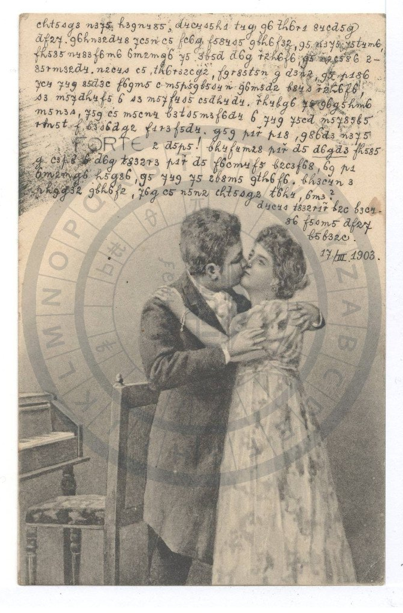
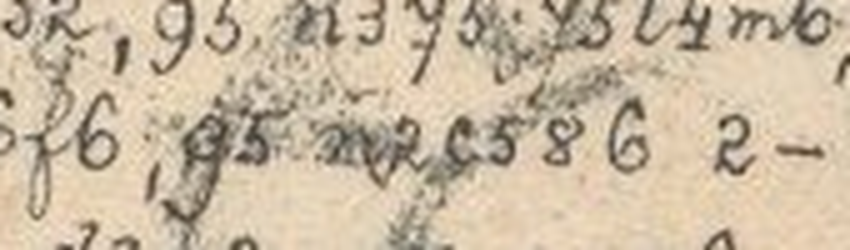
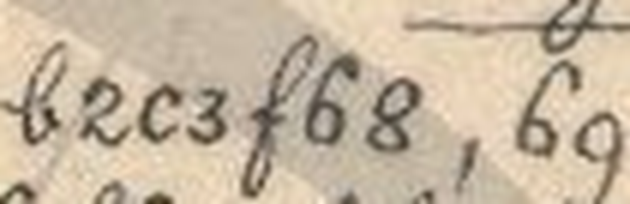

# HCP 1560 (pc_hcp_241): a Czech love letter from Pepouš to Anna Tichá, 17 March 1903

Human solver: Tomáš Pavuk

**Status: deciphered in full (514 cipher signs, 521 letters, of which 5 signs are damaged but read). Independent review 1 gave the verdict REVISE. Four misread words were corrected and the damaged signs were made explicit. The meaning of the letter did not change.** Report dated 2026-10-30.

## Origin and context

The cryptogram is record 1560 of the HC Portal (https://crypto.hcportal.eu/dashboard/cryptograms/1560), portal name pc_hcp_241, part of the HCPortal collection of cryptographic postcards (private collection). When it was captured on 2026-10-28, the portal listed it as follows:

- status: **Not solved**
- tags: Postcard, HCPortal collection
- category: Substitution
- date: 1903-03-17
- language: Czech
- location: Europe
- sender: Unknown
- recipient: Anna Tichá
- attachments: none (no transcription or solution)

It is a picture postcard scanned sideways. Turned upright (90° clockwise), it carries fifteen rows of cipher text. Twelve long rows fill the upper field; row 9 starts to the right of the printed word **FORTE**. Three short rows at the lower right hold the closing and the signature. The date **17.III.1903** is written in plain numerals.

The address side is in plain writing: **Velectěná Slečna / slečna Anna Tichá / učitelka v / Žirovnici / u Počátek** ("Honoured Miss Anna Tichá, teacher in Žirovnice near Počátky", South Bohemia). Diagonal strokes cross out the destination, and a later hand added **v Kamenici nad Lipou** at the lower left. This is an ordinary forwarding or alteration and not part of the cipher. The exact postmark dates were not read.

The card belongs to a family of cipher postcards to Anna Tichá. They are written in the same hand and the same cipher and signed "Pepouš" (a pet form of Josef). Many of them are deciphered in this repository (for example HCP 1520–1527 and 1533–1556). The key was transferred unchanged from those cards (ciphers/hcp-1520/work/key.json). A partial key for the family was published earlier by Maxim Egorov (https://maxim-egorov.dev/research/anna-ticha-postcards/). This card was therefore read with a **known, transferred key**; the key was not recovered from it. No reading of this particular card was supplied or consulted.




## Method

The transcription is **manual**, without OCR. The scan was rotated losslessly to upright (674×1024 pixels). Each of the fifteen rows was read sign by sign from enlarged crops, and the doubtful signs were compared with other occurrences of the same shape on the card. The signs are digit-like and Latin-like cursive shapes, each standing for one letter, plus one capped sign for the digraph CH.

Three places are covered by ink blots or smudges:

- **row 3, after ŽE:** a light grey overprint over three signs, which can be read underneath as `n2c` = MUS (giving MUSELA);
- **row 6, after J:** one smudged sign whose flagged top is that of `5` = E (giving JE);
- **row 10, between SOBĚ and TAK:** a dark smudge over one sign, an upright stroke ending in a lower loop, consistent with `6` = A.

These five signs are marked as damaged in the transcription file (`{…}`), and the decoder prints them in square brackets.

The work was done in three stages. An OpenAI GPT solver (recorded as GPT-6 Codex in the batch log) made the first transcription, row crops and key transfer, and left the three blotted places open. Claude Opus 5.5 then read the blotted places. A separate Claude Opus 5.5 agent reviewed the result independently: it made its own crops and decoded the transcription with its own script, and its findings led to the corrections described under "Review summary".



## Key

The cipher is a monoalphabetic substitution. The labels below are conventional names for the handwritten shapes, not exact reproductions. Note the swapped pairs:

- `m` = N and `n` = M;
- `t` (crossed) = D and `d` (looped) = T;
- `c` (round) = S and `s` (angular) = C;
- `b` = P and `p` = B.

`y` labels the J-shaped sign, and `H` is the capped r-shape for CH.

| Shape | Plain | Shape | Plain | Shape | Plain | Shape | Plain |
|---|---|---|---|---|---|---|---|
| 1 | Y | 2 | U | 3 | O | 4 | I |
| 5 | E | 6 | A | y | J | 8 | L |
| b | P | c | S | d | T | f | V |
| g | K | h | R | m | N | n | M |
| p | B | q | Z | r | H | s | C |
| t | D | H | CH | v | F (unused here) | | |

Diacritics are not encoded: the cipher writes base letters only. The letters G, Q, W and X have no sign and do not occur.

The card has 514 signs. Their frequencies are: 1:10, 2:29, 3:33, 4:34, 5:67, 6:44, 8:23, H:7, b:17, c:28, d:25, f:25, g:20, h:23, m:23, n:17, p:10, q:23, r:8, s:14, t:14, y:20.

## Plaintext

The ciphertext as transcribed, row by row (`{…}` marks a damaged sign that was read):

```text
R01 cht5sg3 n3y5 h3qn485, d4c4s5h1 t4g q6 th6r1 84cd5g
R02 df2y. q6hn32d48 yc5n c5, fc6g f584s5 qbh6f32, q5 n3y5 y5t4m6,
R03 fh585 n483f6m6 6m2mg6 y5 3b5d d6g H2h6f6 q5 {n2c}586 2-
R04 85rm32d4. n2c4c c5 th6r32cg2, fqr85t5n g d3n2, q5 p186
R05 yc4 y4q 85d3c f6qm5 c m5p5qb5s4n q6m5d2 b84s H2h6f6,
R06 s3 m5yth4f5 6 s3 m5yf4s5 c5dh4d4. Hh4bg6 y{5} q6g5hm6
R07 m5n3s, y5q c5 m5cn4 b3ts5m3f6d4 6 y4q y5cd m5y85b5
R08 4rm5t f b3s6dg2 f1r3f5d4. g5q p1H p18, q86d3 n3y5
R09 2 d5p5! bh4f4m28 p1H d5 d6gd3 fh585
R10 g c3p5 {6} d6g t832r3 p1H d5 f6cm4f5 b2c3f68, 6q p1
R11 6m2mg6 h5g86, q5 y4q y5 2b8m5 qth6f6. bh3c4n 3
R12 phqg32 qbh6f2, y6g c5 n5n2 cht5sg2 t6h4, 6m3?
R13 d4c4s t832r1H b2c b3c4-
R14 86 f5sm5 df2y
R15 b5b32c.
```

The literal decryption in base letters (`[…]` = damaged sign, read):

```text
R01 SRDECKO MOJE ROZMILE, TISICERY DIK ZA DRAHY LISTEK
R02 TVUJ. ZARMOUTIL JSEM SE, VSAK VELICE ZPRAVOU, ZE MOJE JEDINA,
R03 VRELE MILOVANA ANUNKA JE OPET TAK CHURAVA ZE [MUS]ELA U-
R04 LEHNOUTI. MUSIS SE DRAHOUSKU, VZHLEDEM K TOMU, ZE BYLA
R05 JSI JIZ LETOS VAZNE S NEBEZPECIM ZANETU PLIC CHURAVA,
R06 CO NEJDRIVE A CO NEJVICE SETRITI. CHRIPKA J[E] ZAKERNA
R07 NEMOC, JEZ SE NESMI PODCENOVATI A JIZ JEST NEJLEPE
R08 IHNED V POCATKU VYHOVETI. KEZ BYCH BYL, ZLATO MOJE
R09 U TEBE! PRIVINUL BYCH TE TAKTO VRELE
R10 K SOBE [A] TAK DLOUHO BYCH TE VASNIVE PUSOVAL, AZ BY
R11 ANUNKA REKLA, ZE JIZ JE UPLNE ZDRAVA. PROSIM O
R12 BRZKOU ZPRAVU, JAK SE MEMU SRDECKU DARI, ANO?
R13 TISIC DLOUHYCH PUS POSI-
R14 LA VECNE TVUJ
R15 PEPOUS.
```

Normalized Czech (diacritics, capitals and word joins are editorial):

**Srdéčko moje rozmilé, tisícerý dík za drahý lístek tvůj. Zarmoutil jsem se však velice zprávou, že moje jediná, vřele milovaná Anunka je opět tak churavá, že musela ulehnouti. Musíš se, drahoušku, vzhledem k tomu, že byla jsi již letos vážně s nebezpečím zánětu plic churavá, co nejdříve a co nejvíce šetřiti. Chřipka je zákeřná nemoc, jež se nesmí podceňovati a jíž jest nejlépe ihned v počátku vyhověti. Kéž bych byl, zlato moje, u tebe! Přivinul bych tě takto vřele k sobě a tak dlouho bych tě vášnivě pusoval, až by Anunka řekla, že již je úplně zdravá. Prosím o brzkou zprávu, jak se mému srdéčku daří, ano? Tisíc dlouhých pus posílá věčně tvůj Pepouš.**

English translation: **My dearest little heart, a thousand thanks for your dear card. But I was very saddened by the news that my one and only, warmly beloved Anunka is so ill again that she had to lie down. Considering that this year you were already seriously ill and in danger of pneumonia, darling, you must take care of yourself as soon and as much as possible. Influenza is a treacherous illness that must not be underestimated and is best attended to right at the start. If only I were with you, my treasure! I would hug you to me this warmly and kiss you so passionately for so long that Anunka would say she is already completely well. Please send news soon of how my little heart is doing, yes? A thousand long kisses from your ever-faithful Pepouš.**

Slovak translation: **Srdiečko moje premilé, tisícorá vďaka za tvoj drahý lístok. Veľmi ma však zarmútila správa, že moja jediná, vrúcne milovaná Anunka je opäť taká chorá, že musela ľahnúť. Musíš sa, drahúšik, vzhľadom na to, že si už tento rok bola vážne chorá s nebezpečenstvom zápalu pľúc, čo najskôr a čo najviac šetriť. Chrípka je zákerná choroba, ktorú nemožno podceňovať a ktorej je najlepšie hneď na začiatku vyhovieť. Kiežby som bol, zlato moje, pri tebe! Takto vrúcne by som ťa privinul k sebe a tak dlho by som ťa vášnivo bozkával, až by Anunka povedala, že je už úplne zdravá. Prosím o skorú správu, ako sa môjmu srdiečku darí, áno? Tisíc dlhých bozkov posiela večne tvoj Pepouš.**

Notes on the reading:

- **Anunka** is a pet form of Anna. **Pepouš** is a pet form of Josef.
- **pusoval** is a colloquial verb for "kissed", from *pusa*, "kiss". The card uses the same word in its closing, *tisíc dlouhých pus*.
- The writer mentions a serious illness of Anna's earlier in 1903 with danger of pneumonia, and now influenza. This fits a card written in mid-March.
- *ulehnouti*, *šetřiti*, *vyhověti*, and *jest* for *je*, are ordinary written Czech of the period.

## Reproduction

From the repository root:

```sh
python3 -I ciphers/hcp-1560/work/decode2.py
```

The script uses only the Python standard library and writes no files. It does the following:

- checks that `work/key.json` equals the family key in ciphers/hcp-1520/work/key.json (plus v = F);
- decodes the manual transcription `work/transcription-r2.txt`;
- stops if any sign has no key entry;
- prints the fifteen literal rows and the line `VERIFY: 15 rows; 514 cipher units (5 damaged but read); 521 letters; CH=7; classes used=22/23; unmapped=0`.

The output is saved as `work/literal-r2.txt`. The script does not read the image; the transcription is manual and was checked independently in review. The round-1 audit script `work/decode.py` is kept only as a historical record and no longer runs.

## Uncertainties

- **The A in row 10 (between SOBĚ and TAK)** is the weakest sign on the card. A single sign lies under a dark smudge, and its visible strokes are consistent with `6` = A. If the smudge were a cancelled stroke and not a letter, the sentence would read the same without "a".
- **MUS (row 3) and E (row 6)** are damaged but legible: MUS through a light overprint, E from the flagged top of the sign.
- **Close calls:** the Z/K pair (`q`/`g`) in ZANETU, ZAKERNA, KEZ and CHRIPKA, and the I/Y pair (`4`/`1`). These were checked against same-card shapes at 2–6×.
- Small accent-like marks above some signs have not been shown to be part of the cipher. The accents in the normalized Czech are editorial.
- The sender is known only as Pepouš; his civil identity is not established. The postmark dates and the reason the address was changed to Kamenice nad Lipou were not established either.
- The key was transferred from the family cards and the published partial key. It was not recovered blind from this card, and it decodes every sign here without change.

## Review summary

Reviewer: Claude Opus 5.5 (Anthropic), a separate agent, round 1. Verdict **REVISE**.

The reviewer decoded the round-1 transcription with its own script and the family key and got output identical to the solver's literal text. It then compared every row with the scan at 2× and the disputed signs at 3–10×. Its findings and what changed:

1. **The documented command did not run.** The round-1 audit script hash-guarded its own record files and broke once SOLUTION.md was edited. It also still decoded three opaque blot markers. *Changed:* a new standard-library command (`work/decode2.py`) decodes the corrected transcription, with the damaged signs entered in it.
2. **BICH (×3) and BIL were misreadings of BYCH and BYL.** The sign after `p` is the footed 1 (Y), as in VYHOVETI, not the open 4 (I). *Changed:* four signs corrected.
3. **LISOVAL was a misreading of PUSOVAL.** The first sign is the tall-looped `b` (P), and the second is the looped `2` (U). *Changed:* the word is now PUSOVAL ("kissed"), and the earlier glosses *lisoval / tisol / líbal* were withdrawn.
4. **The three blotted places are readable signs and were undersold.** *Changed:* MUS, E and A are recorded as damaged-but-read signs with unit counts, and A is flagged as the weakest.
5. **SOLUTION.md contradicted itself.** It called the reading both partial and complete. *Changed:* one current claim with updated counts and translations; the round-1 text is labelled historical.
6. **Attribution was unclear.** *Changed:* the GPT and Claude contributions are now named, as in this report.

The corrections changed the spelling of four words, not the meaning of the letter. *Bych* and *byl* were already the editorial reading, and *pusoval* replaces the gloss *líbal*, which means the same.



## Sources

- HC Portal record 1560, General, Description and Attachments tabs, captured 2026-10-28: https://crypto.hcportal.eu/dashboard/cryptograms/1560 (source/metadata.md).
- Picture side: https://api.hcportal.eu/media/4740/conversions/pc_hcp_241_pic-large.jpg (source/picture.jpg).
- Address side: https://api.hcportal.eu/media/4741/conversions/pc_hcp_241_adr-large.jpg (source/address.jpg).
- Family key: earlier Anna Tichá family cards in this repository, ciphers/hcp-1520/work/key.json.
- Maxim Egorov, Anna Tichá postcards, published partial family key: https://maxim-egorov.dev/research/anna-ticha-postcards/
- AI Decipherment Register (https://ai.hcportal.eu/register/), checked 2026-10-29: no entry for this card.
