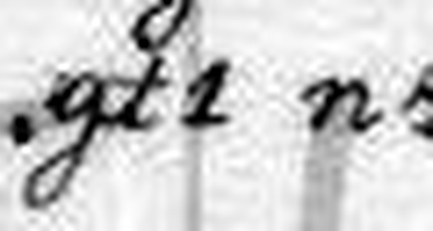
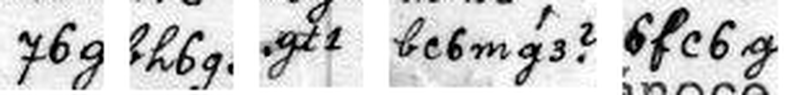

# HCP 1571 (pc_hcp_252): a Czech Christmas love letter from Pepouš to Anna Tichá

Human solver: Tomáš Pavuk

**Status: deciphered in full (475 of 475 cipher signs, 482 letters). Independent review 1 gave the verdict REVISE; in response three single-word transcription corrections were made (KDY, TEBE, BYH), with no change to the key.** Report dated 2026-10-29.

## Origin and context

The cryptogram is record 1571 of the HC Portal (https://crypto.hcportal.eu/dashboard/cryptograms/1571), portal name pc_hcp_252, part of the HCPortal collection of cryptographic postcards (private collection). When it was captured on 2026-10-28 the portal listed it as **Not solved**, category Substitution, date 1902-12-20, language Czech, location Europe, sender Unknown, recipient Anna Tichá, with only the two scans attached (no transcription or solution).

It is a picture postcard printed in grey tones: a young woman with long hair playing a harp, with the printed greeting **Veselé vánoce!** ("Merry Christmas!"). The card is scanned sideways; turned upright (90° clockwise), the cipher text fills nine rows above the picture and four rows below it. Between the two blocks the writer added the plain date **20/XII. 1902.** The large lettered wheel across the picture is the HCPortal watermark, not part of the card.

The address side is in plain writing: **Velectěná Slečna / slečna Anna Tichá / učitelka v Žirovnici / u Počátek** ("Honoured Miss Anna Tichá, teacher in Žirovnice near Počátky", South Bohemia), with the printed multilingual postcard headings, a stamp and postmarks. No cipher text was found on the address side.

The card belongs to a family of cipher postcards to Anna Tichá in the same hand and the same cipher, signed "Pepouš" (a pet form of Josef), many of which are deciphered in this repository (for example HCP 1520–1527, 1537, 1545 and 1556). The key was transferred unchanged from those cards (ciphers/hcp-1520/work/key.json); a partial key for the family was published earlier by Maxim Egorov (https://maxim-egorov.dev/research/anna-ticha-postcards/). This card was therefore read with a **known, transferred key**; it is not a new key recovery. No reading of this particular card was supplied or consulted.


## Method

The transcription is **manual**: the scan was turned upright, and each of the thirteen rows (R01–R09 above the picture, R10–R13 below) was read sign by sign from enlarged crops (work/R01-rawNN.png … R13-rawNN.png). Each row is stored with its crop box in work/transcription.json, and each of the 475 signs with its row and index in work/positions.csv. No OCR was used. Easily confused pairs (K/Z, T/D, P/B, M/N, S/C, I/Y, the CH sign) were checked against other occurrences of the same shapes on the same card (24 control crops, work/C01–C24). Before handover two signs in R11 were corrected by rereading the shapes (the verb ROZEZVUCELA had first been misread as ROZEKVUTELA). These corrections changed the reading of the shapes, never the key.

The signs are a mixture of digit-like shapes and Latin-like cursive letters. Each stands for one plaintext letter, except one special sign (an r-shape with a small cap) that stands for the digraph CH. The family key decodes every sign of this card into connected Czech; no sign is unknown, and every key sign is used.

In review a separate agent made its own upright frame and 4× crops of every row, read the rows independently, decoded the transcription with its own hard-coded key (review/work/indep_decode.py), and checked doubtful signs at 6–12×. It confirmed the reading in general and found one wrong word (see "Review" below).

## Key

Monoalphabetic substitution; the labels are conventional names for the handwritten shapes. Note that `m` stands for N and `n` for M, `t` (crossed) for D and `d` (looped) for T, `c` (round) for S and `s` (angular) for C, `b` for P and `p` for B. `y` labels the J-shaped sign (it looks like a 7), and `H` the capped r-shape for CH.

| Shape | Plain | Shape | Plain | Shape | Plain | Shape | Plain |
|---|---|---|---|---|---|---|---|
| 1 | Y | 2 | U | 3 | O | 4 | I |
| 5 | E | 6 | A | y | J | 8 | L |
| b | P | c | S | d | T | f | V |
| g | K | h | R | m | N | n | M |
| p | B | q | Z | r | H | s | C |
| t | D | H | CH | | | | |

Czech diacritics are not encoded: the cipher writes base letters only (Č as C, Ř as R, Í as I, and so on). F, G, Q, W and X do not occur in this text.

Frequency of each sign on the card (475 in all): 1:14, 2:18, 3:30, 4:35, 5:53, 6:47, 8:19, q:7, g:19, f:22, h:19, t:22, r:8, c:34, s:11, n:20, m:29, p:9, b:15, d:25, y:12, H:7.

## Plaintext

Ciphertext as transcribed, row by row:

```text
R01 d4c4sgh6d t4g. 6m4sg3 n3y5 bh5th6r6, q6 h3qd3n481
R02 84cd5g. n58 p1r fc6g y6 c6n bh4y5d4 c n5d832 m6
R03 6mt58g2, gd5h6 c4s5 nm5 b48m5 m6b3n4m6, 6p1H
R04 c5 c5dh48. 6fc6g c6n6 f86cdm4H cf1H h6t m5tp6 6
R05 t85 n1H c5 m5h4t4. d5c4s c5 nm3r3
R06 m6 cf6dg1? y6 dh6f4d4 y5 p2t2 y6g 3p1s5ym5 f bh6q5.
R07 n6n5 3b5d f 2h6t5 r3tm1 cr3m 6 p2t2 h6t, 6q c5 fc5 3b5d
R08 2g84tm4. m6 d5p5, t2c4sg3 n3y5 fqb3n4m6n t5mm5
R09 h6m3, f5s5h 4 s581 t5m. gt1 n4 b3c85c c84p5m5 bc6mg3?
R10 d6g3f1nd3 6md48g5n, t5f5mg3 n3y5 bh5th6r6,
R11 yc4 d4 6 86cg6 df3y5 h3q5qf2s586 n4 cgf3cdm32
R12 r2tp2 f t2c4!! - d4c4s t832r1H, fh581H, f6cm4f1H
R13 b2c b3c486 d4 f5sm5 df2y b5b32c.
```

Literal Czech, as decoded (base letters only):

```text
TISICKRAT DIK. ANICKO MOJE PREDRAHA, ZA ROZTOMILY
LISTEK. MEL BYH VSAK JA SAM PRIJETI S METLOU NA
ANDELKU, KTERA SICE MNE PILNE NAPOMINA, ABYCH
SE SETRIL. AVSAK SAMA VLASTNICH SVYCH RAD NEDBA A
DLE MYCH SE NERIDI. TESIC SE MNOHO
NA SVATKY? JA TRAVITI JE BUDU JAK OBYCEJNE V PRAZE.
MAME OPET V URADE HODNY SHON A BUDU RAD, AZ SE VSE OPET
UKLIDNI. NA TEBE, DUSICKO MOJE VZPOMINAM DENNE
RANO, VECER I CELY DEN. KDY MI POSLES SLIBENE PSANKO?
TAKOVYMTO ANTILKEM, DEVENKO MOJE PREDRAHA,
JSI TI A LASKA TVOJE ROZEZVUCELA MI SKVOSTNOU
HUDBU V DUSI!! - TISIC DLOUHYCH, VRELYCH, VASNIVYCH
PUS POSILA TI VECNE TVUJ PEPOUS.
```

Normalized Czech (diacritics, capitals, punctuation and four repairs of writer's slips are editorial, see "Uncertainties"):

**Tisíckrát dík, Aničko moje předrahá, za roztomilý lístek. Měl bych však já sám přijeti s metlou na Andělku, která sice mne pilně napomíná, abych se šetřil. Avšak sama vlastních svých rad nedbá a dle mých se neřídí. Těšíš se mnoho na svátky? Já tráviti je budu jak obyčejně v Praze. Máme opět v úřadě hodný shon a budu rád, až se vše opět uklidní. Na tebe, dušičko moje, vzpomínám denně ráno, večer i celý den. Kdy mi pošleš slíbené psánko? Takovýmto andílkem, děvenko moje předrahá, jsi ty, a láska tvoje rozezvučela mi skvostnou hudbu v duši!! — Tisíc dlouhých, vřelých, vášnivých pus posílá ti věčně tvůj Pepouš.**

English translation: **A thousand thanks, my dearest Anička, for the lovely card. But I myself ought to come at Andělka with a rod: she keeps urging me to take care of myself, yet she ignores her own advice and does not follow mine. Are you looking forward to the holidays very much? I will spend them as usual in Prague. At the office we are again very busy, and I will be glad when everything calms down again. I think of you, my darling, every day: in the morning, in the evening and all day long. When will you send me the letter you promised? You are just such a little angel, my dearest girl, and your love has made splendid music sound in my soul!! — A thousand long, warm, passionate kisses, sent to you for ever by your Pepouš.**

Slovak translation: **Tisíckrát ďakujem, moja predrahá Anička, za milý lístok. Mal by som však ja sám prísť s metlou na Andělku, ktorá ma síce usilovne napomína, aby som sa šetril. Sama však na vlastné rady nedbá a mojimi sa neriadi. Veľmi sa tešíš na sviatky? Ja ich strávim ako obyčajne v Prahe. V úrade máme opäť poriadny zhon a budem rád, keď sa všetko zasa upokojí. Na teba, moja dušička, myslím denne ráno, večer aj celý deň. Kedy mi pošleš sľúbený lístok? Takýmto anjelikom si ty, moja predrahá dievčina, a tvoja láska mi rozozvučala nádhernú hudbu v duši!! — Tisíc dlhých, vrúcnych, vášnivých bozkov ti naveky posiela tvoj Pepouš.**

Notes on the reading:

- The letter fits the card. It was written on 20 December and thanks Anna for her card. It asks whether she is looking forward to the holidays (*svátky*) and says Pepouš will spend them as usual in Prague, busy at his office (*úřad*), as in other cards of the family. The closing image of love making "splendid music in the soul" matches the harpist printed on the picture side.
- **Andělka** is read as the name (or pet name) of someone close to the writer who urges him to rest; who she was is not known. *Přijeti s metlou na někoho* ("to come at someone with a rod") is a joking threat.
- **Takovýmto andílkem … jsi ty** ("you are just such a little angel") probably refers to the angel-like harpist on the picture.
- **psánko** is a diminutive of *psaní* ("letter").

## Reproduction

From the repository root:

```sh
/Users/tomaspavuk/.cache/codex-runtimes/codex-primary-runtime/dependencies/python/bin/python3 -I ciphers/hcp-1571/work/decode.py
```

The path above is specific to one machine; any Python 3 with Pillow can be used instead. The script writes no files. It checks:

- the SHA-256 hashes of both scans, of the credited reference files and of all record files;
- that the key equals the family key of ciphers/hcp-1520;
- the decoding of work/transcription.json with work/key.json, and the re-encoding of the entire literal plaintext with the key, compared with the whole transcription;
- all 475 indexed positions, the row counts (41, 37, 36, 38, 26, 40, 42, 38, 41, 36, 38, 36, 26), the 7 marked CH signs and the 482 letters;
- the literal block in SOLUTION.md;
- that the row crops and control crops match the pixels of the scan.

It then prints the thirteen literal rows followed by PASS lines. It runs only in a checkout that contains ciphers/hcp-1520/work/ and batches/easy-2026-10-28/.

## Uncertainties

- **Writer's slips, repaired only in the normalized text:**
  - TESIC for *těšíš*: an angular C-sign where S is meant.
  - ANTILKEM for *andílkem*: the looped T-shape where D is meant. This cipher gives the crossed shape to D and the looped one to T, so the two are easily swapped.
  - TI for *ty*: the word is underlined on the card.
  - BYH for *bych* (R02): the r-sign lacks the small cap that marks CH; all seven other CH signs carry it.
- **Close calls, checked on enlargements by both solver and reviewer:**
  - MNE in R03: a narrow one-hump n followed by a two-hump m; the scan does not support MME.
  - The verb ROZEZVUCELA in R11: two closed 9-like Z-signs and an angular C-sign. The U is a clear `2`, so the scan does not support ROZEZVECELA.
  - The K/Z, D/T, P/B, M/N, S/C and I/Y pairs throughout the text.
- The diacritics and punctuation of the normalized text are editorial; the cipher does not record them.
- Beyond the signature and the text, nothing is known about who "Pepouš" and Andělka were.

## Review

The independent review (review/REVIEW1.md) was done by a separate Claude Opus 5.5 agent. It reran the reproduction command and decoded the transcription with its own script: all 13 rows and 475 signs decoded, and no sign fell outside the key. It also compared every row with its own 4× crops of the scan. It accepted the reading in substance but gave the verdict **REVISE** for these findings:

1. **(major) R09 ZDA → KDY.** The first sign of the word has the open head and looped tail of K, not the closed 9-like Z, and the last sign is a plain `1` (Y), not A. The word is KDY, "when": *Kdy mi pošleš slíbené psánko?* **Fixed.**





2. **(minor) R02 BYCH has no CH mark.** The r-sign is plain, so the literal is BYH, and *bych* is an editorial repair. **Fixed and disclosed.**
3. **(minor) Over-hedged alternatives:** MME and ROZEZVECELA, neither of which the scan supports. **Dropped.**
4. **(minor) Unclear attribution** in the working notes. **Clarified** (see "Credits").

The reviewer also asked for rows R08–R09 to be rechecked sign by sign. The recheck found one more error in the transcription. In R08 the word read as TOBE is `d5p5` = **TEBE**: its second sign has the flat top bar of the E-sign `5`, not the rounded top of the O-sign `3`. *Na tebe … vzpomínám* is also the correct grammatical case after *vzpomínat na*. **Fixed.**


All three corrections concern single signs and leave the sign count (475) and the key unchanged. The sentence-level reading is unchanged except for "Zda mi pošleš" → "Kdy mi pošleš" ("Will you send me" → "When will you send me").

## Credits

Scan download, manual transcription, key transfer and the first full reading were done on 2026-10-28 by an OpenAI GPT solver agent (its handover marker names "OpenAI GPT-6 Codex"). The response to the review, the R08 correction and this report were done by Claude Opus 5.5 on 2026-10-29; the review was done by a separate Claude Opus 5.5 agent. The family key comes from the earlier cards of the Anna Tichá series and from Maxim Egorov's published partial key.
